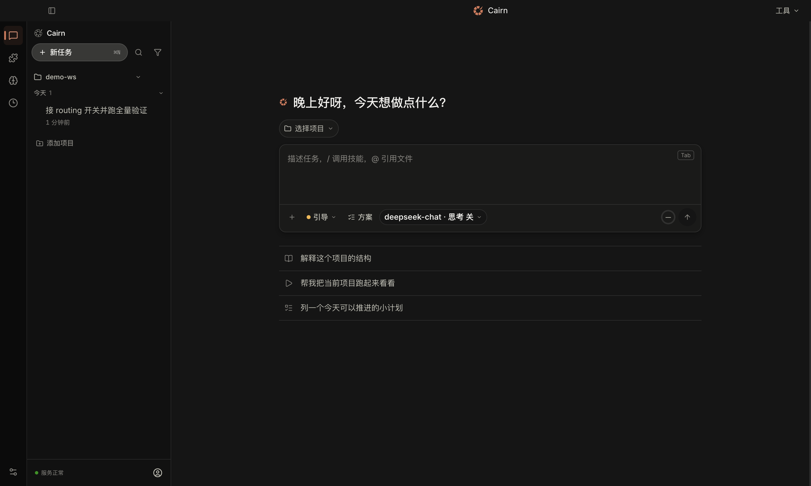
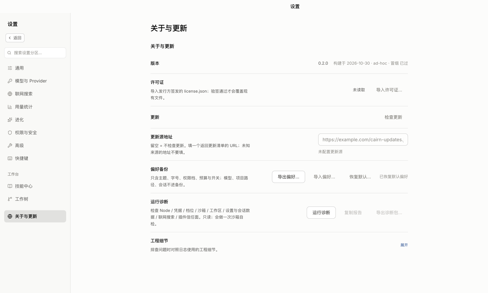

# Cairn — 可重放的 AI 编码 agent

> 事件溯源（event-sourced）的 agent 内核：每一步都落成 JSONL 事件，因此**同一份日志可以被重放、分叉、审计**。

[](https://github.com/W117C/cairn-harness/actions/workflows/verify.yml)
[](./LICENSE)
[](https://nodejs.org)
[](https://pnpm.io)

Cairn 是一个面向本地项目的 AI 编码助手：CLI 和 macOS 桌面应用共用同一套事件溯源内核。
它在你的工作区里读代码、改代码、跑测试，并把每一次工具调用、权限判定和验证结果写进可重放的 JSONL。

> **当前阶段：开发者预览（Developer Preview）。** 交付面是 CLI；桌面应用在 `apps/desktop/`，需要从源码构建或使用本机 ad-hoc 预览包。首次启动向导、签名安装包与英文界面仍在路线中。许可证见 [`LICENSING.md`](LICENSING.md)。

## 快速开始

需要 Node `>=20.11 <25`（以 `package.json` 的 `engines` 为准）与 pnpm 11.21.0（运行 pnpm 需要 Node `>=22.13`）。

```sh
git clone https://github.com/W117C/cairn-harness.git
cd cairn-harness
./scripts/install.sh
./bin/cairn.mjs --doctor
```

没有 API key 也能看一遍完整流程（预录剧本，不拨号、不花钱）：

```sh
./bin/cairn.mjs --provider demo --mode auto --workspace /tmp/cairn-demo "随便写点什么"
```

> **demo 有三件事必须说明：** ① 剧本固定（读 `src/todo.ts` → 写 `src/todo.ts` → 跑 `pnpm test`），与你给的任务无关；② 结尾的「任务完成」是台词，不是判卷结论，请看退出码；③ 它会在 `--workspace` 里真的创建 `src/todo.ts`。想量真实能力用 `pnpm bench`。

真实任务：

```sh
export OPENAI_API_KEY=<你的 key>
./bin/cairn.mjs "把 tests 里失败的那个用例修好"
```

## 这是什么

- **事件溯源**：每轮一份 JSONL，事件 id 就是 1-based 行号；`replay()` 原样返回事件，控制记录由投影解释。
- **可分叉**：会话分叉是 `{parent, boundary}` 指针，不复制父会话事件。
- **fail-closed**：审批没人应答时当场拒绝，不伪装成工具失败；默认档写操作逐次审批。
- **本地优先**：状态、会话、记忆与插件都在本机；凭据只走环境变量，不落文件。
- **可审计**：工具调用、权限判定、验证结果都留痕；`--replay` 能回放一条会话的决策链。

## 桌面应用（macOS）

桌面壳在 `apps/desktop/`（Electron + React + Vite），与 CLI 共用 `src/main/` 服务。
当前构建是 ad-hoc 签名、未公证的开发者预览。





```sh
pnpm install --frozen-lockfile
pnpm --filter cairn-desktop build
pnpm --filter cairn-desktop smoke
node apps/desktop/scripts/package.mjs --out apps/desktop/release-$(date +%Y%m%d)
```

产物含 `Cairn.app`、`Cairn.dmg`（`hdiutil` 不可用时回退 `Cairn-macOS.zip`）、`build-info.json`
（版本、lock 哈希、`packagedSmoke: passed`、签名方式、构建时间）。DMG 内是 `Cairn.app` +
`Applications` 快捷方式与安装说明。当前为 `ad-hoc` 封装，暂不做 Developer ID 签名或 Apple 公证；
首次打开说明见 [`docs/macos-trial.md`](docs/macos-trial.md)，打包细节见 [`docs/desktop-preview.md`](docs/desktop-preview.md)。

发布更新清单：

```sh
node --import tsx scripts/update-manifest.ts \
  --version 0.2.0 \
  --url https://example.com/Cairn.dmg \
  --notes "桌面端 0.2.0" \
  --out update.json
```

清单严格为 `{ version, url, notes? }`：version 必须三段 semver、url 必须 https。

## Provider

| provider | 环境变量 |
|---|---|
| `glm` | `CAIRN_API_KEY` |
| `openai` | `OPENAI_API_KEY` |
| `anthropic` | `ANTHROPIC_API_KEY` |
| `gemini` | `GEMINI_API_KEY` |
| `deepseek` | `DEEPSEEK_API_KEY` |

OpenAI 兼容网关可直接用 `OPENAI_BASE_URL` + `OPENAI_API_KEY`；表外模型用 `--model` 显式点名。
缺 key 会明确报错退出，不会静默换一家、也不会悄悄跑演示档。

## 权限档（默认 fail-closed）

| 档 | 含义 |
|---|---|
| `read-only` | 只读面，写工具一律拒 |
| `default` | **默认档**：写操作逐次审批 |
| `guided` | 按风险分级放行 |
| `auto` | 自动放行——必须显式 `--mode auto` |
| `full-access` | 全部放行（仅限受信任环境） |

审批门在管道 / CI / `--unattended` 下当场按拒绝收束。`run_shell` 在 macOS 上走 Seatbelt 沙箱：
写收敛到工作区、敏感目录拒读、默认断网；沙箱不可用时会明说，不假装有。

## 事件日志

每轮落一份 JSONL，默认在 `<workspace>/.agent/sessions/cli-<时间戳>.jsonl`：

```
user_message → assistant_message → tool_call → tool_result → … → usage
```

重放一份日志：

```ts
import { replay } from "./src/events";
const events = await replay("<path>.jsonl");
```

会话分叉、目标、worker 事件都落在同一份；worker 的 diff 借 `callId: "diff-<agentId>"` 的 `tool_result` 落地。

## 工具

静态注册表 19 个（[`src/tools/index.ts`](src/tools/index.ts)；`tools-check` 钉着这个数）：

`read_file` · `read_image` · `render_image` · `write_file` · `edit_file` · `apply_patch` ·
`run_shell` · `grep` · `glob` · `lsp` · `clarify` · `propose_plan` · `todo_write` ·
`task_output` · `task_stop` · `git_read` · `calc` · `list_dir` · `read_doc`

`verify` — 系统验证门，由 loop 的 verify 钩子处理（未接线 = fail-closed），不在静态工具表里。

运行时还会按装配注入 `remember`、`spawn_agent` / `wait_for_agents` / `cancel_agents`、
`refine_goal`、`web_fetch`、`web_search`、`diagnose`。工具面不是提示词自觉：`allowedTools`
给出时不在表内的工具一律拒绝执行。

## 桌面与 CLI 的结构

- `src/agent/` — 事件循环、编排、worker、压缩、判卷层
- `src/events/` — append-only 事件流 + 重放 / 分叉
- `src/tools/` — 工具实现
- `src/permissions/` — 权限策略
- `src/providers/` — provider 适配器与模型注册表
- `src/main/` — electron-free 的应用服务（装配根）
- `apps/desktop/` — 桌面壳（Electron + React + Vite）
- `scripts/` — 构建、安装、评测与维护脚本

桌面 IPC 现读 **156 个 invoke 通道**（事实源 [`apps/desktop/src/main/channels.ts`](apps/desktop/src/main/channels.ts)，表长判据 [`apps/desktop/tests/channels.test.ts`](apps/desktop/tests/channels.test.ts)）。

## 开发与验证

```sh
pnpm verify          # 公开 CI 的 L1 全套
pnpm typecheck      # 只做类型检查
pnpm test           # 核心行为测试
pnpm test:capped    # 核心测试，限两个 worker（8GB 机器上的可复现读数）
pnpm --filter cairn-desktop test   # 桌面行为测试
```

测试与验证分层见 [`docs/TESTING.md`](docs/TESTING.md)。开发规则见 [`AGENTS.md`](AGENTS.md)；
架构索引见 [`docs/CODE-WIKI.md`](docs/CODE-WIKI.md)。

## 参与、支持与安全

- 贡献流程：[`CONTRIBUTING.md`](CONTRIBUTING.md)
- 问题反馈：[`SUPPORT.md`](SUPPORT.md)
- 安全漏洞：[`SECURITY.md`](SECURITY.md)（走私密通道，不要开公开 Issue）
- 行为准则：[`CODE_OF_CONDUCT.md`](CODE_OF_CONDUCT.md)

## 许可

Cairn 采用 **open-core** 模式：

- 本仓库代码以 **AGPL-3.0-only** 发布，全文见 [`LICENSE`](LICENSE)；
- Cairn 名称、Logo 与品牌视觉保留；商业版/云端/企业模块不在本仓库；
- 需要闭源集成、OEM 或 SaaS 托管可联系维护者获取商业授权。

详见 [`LICENSING.md`](LICENSING.md)。
