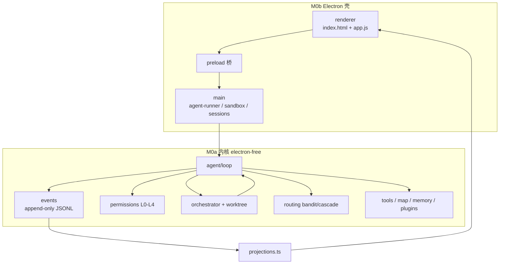

# DSH 项目综合报告（2026-09-22）

> **性质**：只读综合评审 + 文档整理产出。未改 `src/` 业务代码、未跑全量门禁。
> **基线**：工作区在 `codex/dsh-structural-hardening` 线，含在飞未提交改动。
> **数字口径**：均作 2026-09-22 快照；门数/测试数以 `scripts/gate-manifest.ts`、`tests/` 为准，不写死进其他长期文档。
> **与上一轮评审的关系**：吸收 `outputs/project-review-2026-09-21.md` 结构，**更新安全债状态**（该文写「未施工」的 shell 绕过，其后提交已修；探针本日复跑 **红 0 / 绿 33**）。

---

## 一、项目是什么

**DSH（deepseek harness / 包名 `m0-agent-loop` v0.0.1）** 是一个 **Electron 桌面编程 Agent**：用户像指挥官一样调度多个并行干活的 agent，每个动作以结构化卡片呈现，可点、可批、可回溯。核心卖点是 **看得见的指挥 + 少改代码 + 结果可判卷**。

| 维度 | 现状（2026-09-22 快照） |
|---|---|
| 技术栈 | Node 22 / TypeScript 5 / electron-vite 5 / Electron 44 / vitest 5 |
| 渲染层 | **手写 vanilla**（`index.html` 单文件内联 CSS + `app.js` 纯 ESM）；**无 React / Tailwind / shadcn 运行时** |
| 架构 | 事件溯源：**一条 append-only JSONL 事件流贯穿一切**；M0a 内核 electron-free，可 headless 直跑 |
| 规模 | `src/` 约 **34,007 行**；`tests/` **196** 个测试文件 |
| 门禁 | `scripts/gate-manifest.ts` 清单 **33** 道（含 mutate-verify、arch-boundary、ipc-reachability 等） |
| 里程碑 | M0–M5 全收口 + M6 已收（supervise 接线、多 provider 价格表）；M7 影响面/经济簇与判断层校准**在飞** |
| 商业形态 | BYOK 本地优先（key 入 safeStorage）；macOS + Seatbelt 沙箱；**unsigned V1 边界**（无签名/公证） |
| 出厂默认 | 偏「演示壳」：差异化开关缺省关——能力在，用户未默认拿到 |

### 1.1 架构一览



**模块职责速览**（详见 `docs/CODE-WIKI.md`，注意其渲染层章节已过时）：

- `src/agent/` — loop、压缩/prune、编排、记忆、插件、gym 靶场、安全扫描、solpi/goal 等
- `src/events/` — 事件契约、追加、重放、增量重放（叶子层，禁反向依赖）
- `src/tools/` — read/write/edit/grep/glob/shell/lsp/snapshot/impact…
- `src/permissions/` — 规则、风险、自治档位、命令形状
- `src/providers/` — Anthropic / OpenAI / Gemini / GLM / mock + 重试与 stop-reason
- `src/routing/` — 档位表、策略、bandit、级联升档
- `src/main/` — Electron 主进程、沙箱、调度、license、BYOK
- `src/renderer/` — vanilla UI + `projections.ts` 纯投影

---

## 二、文档区地图（本次整理）

完整导航见 **`docs/DOCS-MAP.md`**。效力分层：

| 层 | 代表 | 效力 |
|---|---|---|
| **权威** | `agent-plan.md`（意图）、`scripts/gate-manifest.ts`+`tests/`（数字）、`AGENTS.md`（工程现状）、`docs/ui-fact-baseline.md`（UI 事实） | 当前可信 |
| **验收** | `docs/m{2,3,4,5}-acceptance.md`、`*-audit.md` | 三态证据（已证/未证/留位） |
| **过程史** | `PROGRESS.md`、`BLOCKED.md` | 为什么这么做；不回改 |
| **调研/评审** | `outputs/**`（80+ dated 页） | 当日快照；引用前看失效条件 |
| **历史 UI 证据** | `docs/*.png` | 迁移前 React 界面，勿当现状 |
| **已降档** | `overview.md`、`CODE-WIKI.md` 渲染层节、`frontend-refactor-2026-09-17/` 数字层 | 文内有 banner |

**整理原则（本次遵守）**：只加导航与报告，**不回改、不删除**历史 dated 页；不把滚动数字写死进长期文档。

---

## 三、优点（带证据指针）

### 3.1 架构根基正：事件溯源是真纪律

- 全系统单一事实源 = append-only JSONL；会话可重放、可分叉（fork 前 N 条逐字节一致）、崩溃可恢复。
- 24+ 事件类型有 `KNOWN_TYPES` 登记闸；投影层（`projections.ts`）与事件层分离，渲染层禁挂演示常量。
- M0a 不依赖 Electron → 同一 `runLoop` 服务桌面壳与 30+ 道 headless check。`arch-boundary-check` 把这条不变量变成可红的门。

### 3.2 验收文化是仓库最强资产（业内罕见）

- **清单即事实源** + 孤儿脚本机械校验；门数不写死进文档。
- **变异测试常态化**（`mutate-verify` 全表「全杀」语义 + 秒级 needles 预检）。
- **判卷文件 sha256 冻结**；改判据走 `BLOCKED.md`，不改代码绕。
- **fail-visible /「未证 ≠ 通过」**：三态验收 + `DSH_STRICT_UNVERIFIED=1` 严格模式 + 降级分支显式打印。

### 3.3 成本 / Token 工程有实测闭环

- 影响面上下文：逐条注入最坏 ≈2112 token → 文件级汇聚 ≈168 token（**−92%**）。
- 事件落盘：每事件 open/write/close（1930µs）→ 常驻 FileHandle（9.8µs，**196×**）。
- prompt cache 断点、价格表（缓存价「待校准」不编数）、gym 装配探针拆账（短任务钱在工具面 ≈90%）。

### 3.4 多 agent 编排是完整闭环而非 Demo

spawn_agent（read/write）→ worktree 隔离 → **语义合并闸**（影响面升级为 spawn 准入）→ 合并控制塔（证据四态）→ 崩溃恢复/卡死闸 → bandit 路由（真钱代价）→ cascade 升档（客观 `verified` only，预算整链共享）。每一环有事件与断言。

### 3.5 安全模型可被机械证伪（且最近刚补过硬）

- 三层防御：OS 沙箱（Seatbelt）→ 审批出口 → 危险命令静态快筛；自治 L0–L4；产出代码安全 off/report/gate。
- **shell 权限绕过四条已修完**：`scripts/probe-shell-bypass.ts` 本日复跑 **红 0 / 绿 33**（包装器/绝对路径/bash -c/环境赋值/重定向写面/git 闸）。
- 覆盖前快照（D7）已接写路径；网络审批放行支、模块方向门已落施工（见 `outputs/architecture-uplift-2026-09-21.md` §7）。

### 3.6 文档即历史，诚实性制度化

- 过期快照**标注但不改写**（「改写即伪造历史」）；失效条件挂可判读事实、禁挂 SHA。
- 「两头断」（模块/事件/消费端齐了、写路径没接）历史上多次，已沉淀为可达性门禁（`ipc-reachability-check` 等）。
- 环境陷阱（shell `grep` 的 `\b`、safe-delete 假红、TERM ANSI、panels-check flake）写成判读规则，而不是静默吞掉。

---

## 四、缺点与风险（按严重度）

### 4.1 【P0→已缓解·安全】权限绕过面

- **09-21 评审写「未施工」的包装器绕过，现已收口**（提交链 `5b6a7d5` → `36cfd56` → `36deb94` 等；探针红 24→0）。
- **残余风险**：`NETWORK_RE` 不认 `git clone/fetch/pull`、`npm i <pkg>`、`pip install` ⇒ 这些命令仍拿不到网络放行资格（行为与修前一致，未恶化）；长期看分类面要扩，但须与权限层改动错峰。

### 4.2 【P0·工程】渲染层是「长大的，不是设计的」

- 分派靠**覆写而非接口**（桥接段整份覆写原型段函数）；状态多源；`index.html` 2000+ 行内联 CSS 单文件扛全部设计系统。
- 测试用 vm 切片 `app.js`，对函数作用域是隐式依赖（已炸过一次「断言绿但门红」）。
- **诊断与提案已备**（`renderer-refactor-proposal-2026-09-19.md`），欠的是施工排期——这是当前最大的工程结构债。

### 4.3 【P1·产品完整性】已发货能力与用户可见性之间仍有欠账

- 孤儿 IPC 桥：曾实测 20 条渲染层零入口；现基线已棘轮下降（以 `ipc-reachability-check` 为准），但「能力在、点不到」的形态仍在。
- 面板留位：`WORKSPACES` / `BRANCHES` 仍是演示数据；`promptCache` 等开关无渲染层入口。
- 多个差异化模块（routingBandit / actionFusion / metering / observationPack / evidenceReceipts / economicCompaction / impactAnalysis / autoVerify）**有调用者、缺省全关**——纪律正确（无真模型证据不宣称收益），但用户今天拿不到卖点。

### 4.4 【P1·方案与实现的悬空行】

| 方案书承诺 | 现状 |
|---|---|
| 网络审批后放行（§11.4） | 施工回执已有放行支（architecture-uplift §7），须并门禁验收 |
| 覆盖前快照（§10.4） | **半兑现**：agent 可自取原件；人侧「一键还原」未做 |
| 模型面工具/MCP 总预算 | 读数已有（每请求固定面 ≈9.7KB，工具占 84%），**总量闸未施工** |
| 长命令出口 | 60s 硬顶 + 无常驻进程句柄（先补靶面） |
| 四模块禁区门 | `arch-boundary-check` 已落（须进清单并持续绿） |

### 4.5 【P1·可靠性】门禁环境脆弱点多

- `panels-check` 真实 Electron + CDP，高负载 flake（判读法 = 单跑复验）；B2 徽标时延类残余仍在。
- 环境陷阱密集：safe-delete 假红、`TERM` ANSI 假红、沙箱内 pnpm test、macOS realpath。**新人第一次跑全表大概率撞墙**。
- 长期「未证」项（testdino 远程 MCP、provider 真连、各 check 暗卷段）⇒「全绿」永远带脚注；缓存价格 12 档未校准。
- **CI 缺位**：全表靠本地 `pnpm gates`，反馈延迟与 flake 判读全靠人。

### 4.6 【P2·工程卫生】并发工作区与巨型文档

- 多会话并行开发留下过「拆开提交 → HEAD 悬空」多起；相交检查纪律靠人。
- 本日工作区仍有约 32 个已跟踪文件在飞 diff + 大量未跟踪调研产物——收口成本随会话数上升。
- `agent-plan.md` ≈223KB、`PROGRESS.md` ≈235KB、`BLOCKED.md` ≈101KB 巨型单文件；`outputs/` 80+ 条目语义混杂（调研/设计/读数/废稿）。
- 超大源文件：`orchestrator.ts` 2410 行、`agent-runner.ts` 2212 行、`app.js` 4371 行。

### 4.7 【P2·商业边界】V1 明确取舍（备案，非缺陷）

unsigned 包（首次需右键打开）、license 仅离线 Ed25519、无遥测上报、官方仅 macOS。每条都是 **GA 前必办**。

---

## 五、需要优化改进（按投入产出比）

### 5.1 立刻（本周）

| # | 项 | 依据 | 预期收益 |
|---|---|---|---|
| I1 | **在飞改动成组提交**，提交前 `git worktree add` + `tsc --noEmit` 验 HEAD 自洽 | AGENTS.md 相交检查教训 | 消除 HEAD 悬空 |
| I2 | **把 `probe-shell-bypass` / arch-boundary 等新门挂进 `gate-manifest` 清单**并单跑复绿 | 清单即事实源 | 安全与边界不回退 |
| I3 | **D7 人侧还原出口**（文件卡/审批卡「还原到覆盖前」） | architecture-uplift §2.2 留尾 | 方案书 §10.4 完全兑现 |
| I4 | 文档指针体检：`DOCS-MAP.md` 当唯一导航；假指针只留 banner | 本次整理发现 | 降低误引 |

### 5.2 短期（1–2 周）

| # | 项 | 依据 | 预期收益 |
|---|---|---|---|
| S1 | **渲染层结构偿还**：消灭覆写式分派 → 注册表；状态收单一源；CSS 切三层令牌 | `renderer-refactor-proposal-2026-09-19` | 可维护性 + 测试稳定性 |
| S2 | **模型面预算闸**：`sessionToolSpecs` 给 MCP/插件工具加总量上限（对齐 skill/hook） | architecture-uplift §2.3 | 防多 MCP 拖垮每轮固定成本 |
| S3 | **判断层第 0–1 步**：verify 归因 + 拆短路（让风险层真有决策权） | `judgment-layer-calibration-proposal` §9/§7 | 自治可调、可判卷 |
| S4 | **网络分类面扩** + 网络放行支并入 sandbox-check 常门 | architecture-uplift §2.1 留尾 | 真联网工具可用 |
| S5 | **孤儿 IPC R1c 收口** + WORKSPACES/BRANCHES/promptCache 真数据上屏 | reachability 棘轮 | 卖点到用户手里 |
| S6 | **panels-check B2** settle 同款「连续两次稳定」 | 09-21 评审 O2 | 残余 flake 清零 |

### 5.3 中期（1–2 月）

| # | 项 | 依据 | 预期收益 |
|---|---|---|---|
| M1 | **CI 化**：`pnpm gates --direct` + 有凭据环境 `STRICT_UNVERIFIED`；flaky 门自动单跑复验 | 09-21 评审 O1 | 反馈延迟与信任损耗下降 |
| M2 | **巨型文档切片**（须先合并 `doc-layer-migration`，再补 `agent-plan` 未覆盖面） | O3 + 分支任务 #1 | 检索/上下文成本 |
| M3 | **工具契约声明化**（超时/上限/风险/沙箱需求单源） | architecture-uplift §3 | 消灭 20 处出口副本 |
| M4 | **工具表瘦身**（remember/spawn_agent/lsp 占工具面约 50%）+ 会话阶段裁剪 | 装配探针 | 短任务成本再降 |
| M5 | **gym 多轮 / 长命令靶面**（现 case 偏单轮） | m5-acceptance / uplift §2.4 | 压缩、缓存、长时程可评测 |
| M6 | **cascade `$ / 成功任务` 实测** + 缓存价格联网校准 | m5-acceptance 未证项 | 花钱能力证明「划算」后再改默认 |

### 5.4 明确不做 / 刻意推迟（防争论重启）

- laya/JEV 类 System 1 模型（已评估结题不接入）
- React/Tailwind 回摆、ACP 进程外子代理、容器/microVM、embedding 向量检索
- 60+ 包 Cordis 插件树、YAML 架构政策形态
- code-mode / PTC：**方向接受，施工推迟**（先补靶面）
- 团队版协作（V1.1）、electron-updater 自动安装（V1 轻检查已够）

---

## 六、未来发展路径（按依赖序）

### 第 0 批 · 还清工程与安全尾巴（阻塞对外分发）

1. 在飞簇成组提交 + HEAD 自洽验证。
2. 新门进清单（probe-shell-bypass、arch-boundary、snapshot/网络相关）。
3. D7 人侧还原；网络放行支完整验收。
4. 价格表「待校准」保持可见，不编数。

**出口判据**：`pnpm gates` 全绿可复跑；安全探针保持全绿；无未收口的方案书悬空行（或明确记入 BLOCKED）。

### 第 1 批 · 判断层校准（已在飞，按既定四步）

verify 归因 → ask 落盘（已做）→ 拆短路 → 后验频率概率 → 仅在三条接入前提满足时才谈外部决策模型。  
**目标**：不是「少问人」，而是 **default 与 auto 之间的连续地带可调、可判卷**。

### 第 2 批 · 把已发货能力变成价值

- R1c 孤儿桥逐条三选一（接 UI / 降内部 API / 删）。
- R2 演示数据真化；`promptCache` 等开关上屏。
- 新手引导补「第一次并行编排」（卖点是指挥，引导却不教指挥）。
- 八模块里已有实测收益的（impact、autoVerify、bandit）给**可感知默认策略**（仍保留严格档）。

### 第 3 批 · 渲染层结构偿还

按 `renderer-refactor-proposal-2026-09-19.md`：先加结构性门禁再动手；设计语言五条（三层令牌 / 偏蓝灰 / alpha 边框 / 0.5px 发丝线 / superellipse）可与结构正交并行。  
**目标**：单一分派面 + 单一状态源 + 可组件测试。

### 第 4 批 · 让花钱的能力证明「划算」

- cascade 升档的 `$ / 成功任务`；多轮 gym；长命令靶面。
- 经济压缩、观察包、证据回执逐项「开/关」对照读数。
- 模型面预算闸 + 工具表瘦身形成**成本仪表**（每任务固定成本/变动成本可见）。

### 第 5 批 · GA 边界解除

签名/公证 → license 服务端 → opt-in 遥测 → Windows/Linux 沙箱产品化表述 → `pnpm dist` 进 CI。  
**每解一条，unsigned/单平台/离线 license 的「V1 边界」注记同步降档。**

### 长期护城河（harness-only 能赢的部分）

对照 `outputs/best-agent-roadmap-2026-09-18.md`：模型与流量赢不了；能赢的是——

1. **工具结果截断/压缩策略**变成可发表数字（`prune` 机制已在，缺对外读数）。
2. **压缩与缓存成本核算**透明（价格表 + cacheRead 折扣 + 任务账单）。
3. **长时程可恢复**（事件溯源 + 崩溃恢复已是半成品，补产品叙事）。
4. **判卷完整性工程**（变异 + 冻结 + 三态）——行业未见同构，但**还没发货**；可产品化为「可审计执行」信任面。

---

## 七、总评

**这是一个工程纪律显著高于平均水平的项目**：事件溯源被真正贯彻，变异测试与冻结判卷把「测试真实性」当一等公民，成本优化有实测闭环，「未证 ≠ 通过」诚实性制度化。多 agent 编排是完整闭环而非 Demo。

短板不在「有没有能力」，而在三处：

1. **渲染层结构欠账**——诊断完成、提案齐备，欠施工；
2. **能力到用户的最后一跳**——孤儿桥、演示数据、缺省全关的差异化模块；
3. **对外可分发性**——签名/多平台/license 服务端/CI。

安全上的最大单点风险（deny 被包装写法击穿）**已在本日之前收口**，这是相对 09-21 评审最重要的状态变化。接下来 2–4 周的关键路径是：**收口在飞 → 判断层第 0–1 步 → 渲染层偿还并行上屏欠账**；花钱类能力用读数说话后再改默认。

---

## 附录 A · 关键复跑命令

```sh
# 全量门禁（清单即事实源）
TERM=dumb pnpm gates

# 安全探针（期望红 0）
pnpm exec tsx scripts/probe-shell-bypass.ts

# 模块方向门
pnpm arch-boundary-check

# 规模快照
find src \( -name "*.ts" -o -name "*.js" \) -print0 | xargs -0 wc -l | tail -1
find tests -name "*.ts" | wc -l

# 门数
node --import tsx -e 'import {GATES} from "./scripts/gate-manifest.ts"; console.log(GATES.length)'
```

## 附录 B · 本次文档整理清单

| 动作 | 路径 |
|---|---|
| 新增全库导航 | `docs/DOCS-MAP.md` |
| 新增综合报告（本文） | `docs/PROJECT-REPORT-2026-09-22.md` |
| 更新 docs 索引与安全债状态 | `docs/README.md` |
| 未改 | `agent-plan.md` / `PROGRESS.md` / `BLOCKED.md` / 历史 `outputs/**` / 截图 |
