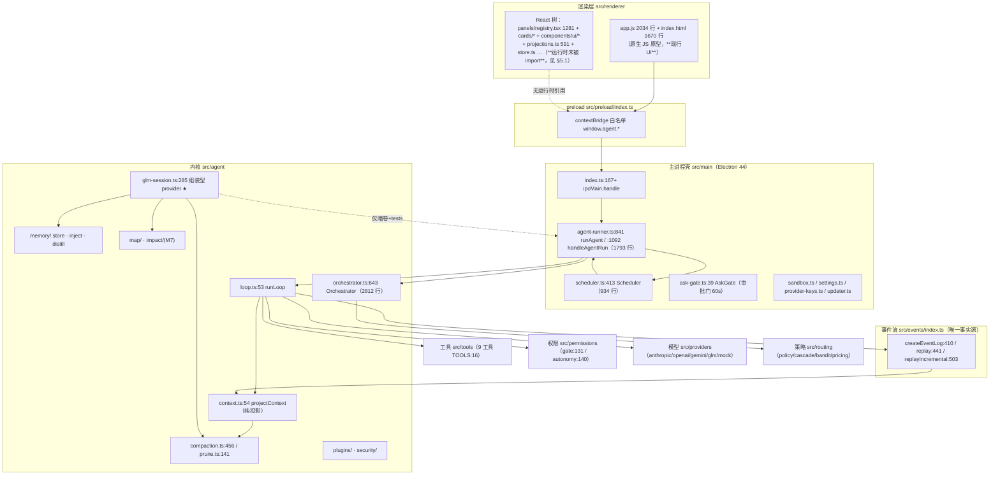

> **⚠️ 存档（2026-09-19 入库时追注，正文一字未改）**：本文是 2026-09-15 那轮的带日期快照，
> 其中的「现状 / 实测」数字与文件行数已漂移；其 P0 结论中「错误无事件化」一条
> **已于 2026-09-19 由 `eafcbfb` 收口**（`RunErrorEvent` + live/replay 两路失败卡）。
> **现权威两面**：意图 = `agent-plan.md` §10.1；事实 = `docs/ui-fact-baseline.md`（每项配复跑命令）。

# DSH Agent 综合评审报告 · 架构 / 功能缺口 / 优化方案

| 项 | 值 |
| --- | --- |
| 报告方 | 软件开发团队 · 主理人 **齐活林（Qi）** 汇总 |
| 分工 | **高见远（Gao）· 架构师** → 架构梳理 + 功能缺口 + 完善方案（`outputs/analysis-arch-2026-09-15.md`）<br/>**寇豆码（Kou）· 工程师** → 代码质量 + 响应延迟 + 资源消耗（`outputs/analysis-perf-2026-09-15.md`） |
| 日期 | 2026-09-15 |
| 对象 | `/Users/ze/Downloads/deepseek harness`（DSH，Electron 桌面编程 Agent） |
| 范围 | **只读分析，未改动任何 src 代码**；未跑门禁（只读约定） |
| 方法 | 实读源码（Read/Grep/Glob/wc），结论附 `file:line`；推断项显式标「待证」 |
| 规模基线 | `src/**/*.{ts,tsx}` = **129 文件 / 26,349 行**；另 `renderer/app.js` 2,034 行 + `index.html` 1,670 行 |

---

## 0. TL;DR

**一句话**：这是一个**架构纪律极强、但「完整 agentic 能力」与「生产热路径」尚未接通**的项目——问题不在代码脏，而在**关键能力没接上线**与**长会话下的 O(n²) 退化**。

### 四个最重要的结论

1. **【P0·功能性】生产真模型路径是演示通道**——`agent-runner.ts:797` 在 `M0A_PROVIDER=glm` 时返回「单轮、无 tools、忽略 messages」的 provider；而承载 **压缩 / prune / 记忆注入 / 符号地图 / 工具结果回灌** 的组装型 provider `createGlmSessionProvider`（`glm-session.ts:285`）**只被 `scripts/gate-check.ts:233`（暗卷）与 `tests/` 消费**。即：agentic 会话能力**已实现但不在生产热路径**。

2. **【P0·可用性】模型/网络错误无事件化**——`loop.ts:79` 的 `for await` 无 try/catch；`AgentEvent` union（`events/index.ts:347-372`）与 `KNOWN_TYPES`（`:375`）**均无 error 类型**。provider 抛错直接冒泡，事件流里看不到失败，UI 静默、日志戛然而止。

3. **【P0·性能·实测新发现】事件落盘是「每事件一次 open+write+close」**——`loop.ts:80` 对**每个**事件（含每个流式 token 块）`await events.append()`，而 `events/index.ts:427` 的 append 实现是 `appendFile()`（每次 open+write+close）。**实测 1,930 µs/事件**；对照实验：常驻文件句柄 **9.8 µs**、常驻句柄 + 32 条微批 **0.56 µs**（快 196× / 3,446×）。一轮 2,000 个流式块的回答 = **约 3.9 秒纯磁盘 I/O**，且因 `await` 位于模型流的 `for await` 之内，**逐 token 阻塞模型流**。这是本轮**唯一被实测证实**的真实延迟瓶颈。

4. **【P2·性能】「每轮 O(n) 全量重算」形状成立但量级很小（已下调）**——`projectContext` + `calibrateFactor` 在 `loop.ts:79` / `orchestrator.ts:2759` / `glm-session.ts:316` / `sidechat.ts:243` 四处每轮全量遍历，O(n²) 形状成立。但**实测**（§8）：15,840 事件单次投影仅 **1.16 ms**；800 轮 / 36,000 事件会话累计 **1.5 s**、末轮约 **3.8 ms**——相对 LLM 往返可忽略。**原 P0-1 严重度经实测下调为 P2**（工程师原判「全仓最大的延迟放大器」不成立）。

### 代码卫生成绩（正面）

`as any` = **0**、`: any` = **0**、`@ts-ignore` = **0**、`TODO/FIXME/HACK` = **0**；无 3 级相对路径；无 `agent`→`main` 反向依赖；Abort 监听 6 注册/6 摘除成对；子进程 `will-quit` 统一收口。**这些是同类项目里的硬成绩，应作为新功能的验证基座。**

---

## 1. 架构与核心模块

### 1.1 分层架构（含本轮核验修正）



> ★ = 组装型 provider（具备全部 agentic 能力），当前**不在生产热路径**。

### 1.2 核心模块清单（职责 · 入口符号 · 关键依赖）

| 模块 | 职责 | 关键入口（file:line） | 关键依赖 |
| --- | --- | --- | --- |
| **events** | append-only JSONL 事件流：唯一事实源；重放/增量/分支 | `createEventLog` `events/index.ts:410`；`replay` `:441`；`replayIncremental` `:503` | node:fs |
| **agent/loop** | agent loop：事件流→模型→工具→事件流，轮内交错 | `runLoop` `agent/loop.ts:53` | events/providers/permissions/tools/context |
| **agent/context** | 事件→消息投影（纯函数、幂等、compaction 感知） | `projectContext` `context.ts:54`；`excludedIds` `:43` | events |
| **agent/compaction** | 阈值摘要压缩：双条件触发→切点纪律→六段模板→三闸 | `runCompaction` `compaction.ts:456`；`CompactionCoordinator` `:562` | context/shape/events |
| **agent/prune** | 类型化裁剪（零 LLM）：保护区 40k / 最小 20k / 近 2 轮免剪 | `computePrune` `prune.ts:141`；`buildPruneIndex` `:92` | events |
| **agent/memory** | 两层记忆（项目 `.agent/` + 全局）：写入/注入/蒸馏 | `writeTopic` `memory/store.ts:251`；`buildMemoryInjection` `memory/inject.ts:163`；`runSessionEndDistill` `distill.ts:40` | events/shape |
| **agent/orchestrator** | 多 agent 编排：spawn/pipeline/supervise/worktree/审批/合并/卡死 | `Orchestrator` `orchestrator.ts:643`；`spawn` `:739`；`spawnRace` `:809`；`spawnPipeline` `:1292`；`mergeWorker` `:2213` | loop/worktree/sequencer/stuck/routing |
| **agent/glm-session** | **组装型 provider**：日志→prune+compaction+记忆+地图→多轮 | `createGlmSessionProvider` `glm-session.ts:285`；`composeTurnMessages` `:262` | events/context/prune/compaction/memory/map |
| **agent/impact（M7）** | 跨文件影响面：def/ref 边 + {mtime,size} 增量 | `buildImpact` `impact/index.ts:109`；`fileImpact` `:250`；`defaultImpactHook` `:279` | map/parse、map/build |
| **tools** | 9 工具注册表 + 统一 Tool 接口 + 路径信任边界 | `TOOLS` `tools/index.ts:16`；`Tool` `base.ts:56` | process/lsp |
| **permissions** | 权限门：档位 + 四层评估管线（规则/风险/沙箱） | `checkPermission` `permissions/index.ts:122`；`gate` `:131`；`evaluate` `autonomy.ts:140` | rules/risk |
| **providers** | 统一 `stream(messages, tools?)`，四家 + mock | `Provider` `providers/index.ts:32`；`streamAnthropic` `anthropic.ts:116`；`streamOpenAI` `openai.ts:89` | net |
| **routing** | 档位表 + 纯函数路由 + 级联升级 + bandit | `routeFor` `routing/policy.ts:72`；`runCascade` `cascade.ts:42` | providers/registry |
| **main/agent-runner** | 主进程 agent 门面（run 装配 / 会话 / 记忆快照 / IPC） | `runAgent` `agent-runner.ts:841`；`handleAgentRun` `:1092` | 内核全部 |
| **main/scheduler** | 定时任务：1min tick + journal + 三闸 + 无人值守 fail-closed | `Scheduler` `scheduler.ts:413`；`tick` `:505` | agent-runner/events |

### 1.3 一轮对话的数据流（关键节点）

```
用户输入
 → renderer app.js → preload → main/index.ts ipcMain.handle("agent:run")
 → agent-runner.ts:1092 handleAgentRun → :841 runAgent
 → events/index.ts:410 createEventLog(logPath)
 → agent/loop.ts:53 runLoop
      每轮 step < maxSteps(50)（loop.ts:76）
        streamFn(projectContext(seen))            ← loop.ts:79  ★每轮全量投影
        events.append(output)                     ← loop.ts:80  ★每事件一次 appendFile
        ├─ verify 分支：反射循环（成功即停 / 上限即停）  ← loop.ts:87-137
        └─ 普通工具：白名单硬闸(:141) → PreToolUse hook(:153)
                    → gate(mode,name,interactive)(:177) → tool.run(:203)
                    → PostToolUse hook(:212) → tool_result 落流(:225)
      无 tool_call（纯文本轮）→ return                ← loop.ts:233
 → 会话尾：Stop/SessionEnd hooks + 安全 report + 记忆沉淀（agent-runner.ts:981-1060）
 → 事件旁路：pipeline → onEvent → preload → renderer（先落 JSONL 再回调，磁盘即事实源）
```

**机制注记**：权限门**双入口**（主 loop 用 `loop.ts:177 gate`；写向工具用 `agent-runner.ts:263 gatedTool`）；`AsyncLocalStorage` 做 run 级隔离（`agent-runner.ts:174 runScopeALS` + `permissions/index.ts:69 planScopeALS`）。

---

## 2. 功能缺口清单（四维度 · P0–P3 分级）

### 2.1 工具调用

| 编号 | 现象 | 证据 | 影响 | 级别 |
| --- | --- | --- | --- | --- |
| **T-1** | 生产 loop **不把工具面交给模型**：`streamFn(projectContext(seen))` 只传 messages，`tools` 第二参恒 `undefined` | `loop.ts:64-67`、`loop.ts:79`；`gateToolSpecs`（`glm-session.ts:30`）仅暗卷/sidechat 用 | 真模型看不到工具 schema，无法发起工具调用 | **P1** |
| **T-2** | 生产真模型 provider 是「单轮、无工具、无回灌」演示通道：`gen` 只建一次、忽略入参 messages | `agent-runner.ts:797-827`（注释自陈「M1a 真流式演示通道…无 tools，纯文本」） | 生产无多轮闭环、无结果回灌、无压缩/记忆/地图 | **P0** |
| **T-3** | 并行工具调用**串行执行**：for-await 内逐个 `await tool.run` | `loop.ts:79-232`；provider 侧已支持多 tool_call（`anthropic.ts:167`、`openai.ts:165`） | 多工具轮次延迟叠加（无 `Promise.all`） | P2 |
| **T-4** | **MCP 工具结果无任何大小上限**（其余工具各有帽：read 50KB、shell 32KB、grep 100 命中） | `mcp.ts:191-200`；loop 侧 `tool_result` 无全局帽 `loop.ts:225` | 超大结果直进事件流→投影→上下文 | P2 |
| **T-5** | **无失败重试**：providers 无 429/5xx 重试；仅 compaction 有 1 次退避 | `openai.ts:127-131`、`anthropic.ts:150-154`；`compaction.ts:528` | 瞬时抖动直接终结本轮 | P2 |
| **T-6** | 超时/取消覆盖不均：**MCP `callTool` 未接 `ctx.signal`**，120s 偏长 | `mcp.ts:13/17/186`；loop 已透传 signal `loop.ts:200` | 取消 run 后 MCP 在途调用仍挂至 120s | P2 |
| **T-7** | 工具发现静态：MCP `tools/list` 仅 connect 时拉一次、**无自动重连**；LSP 需显式配置 | `mcp.ts:137,146-159`（注释「重连留位」）、`lsp.ts:45-78` | server 崩溃后该 MCP 工具永久不可用 | P3 |

### 2.2 记忆管理

| 编号 | 现象 | 证据 | 影响 | 级别 |
| --- | --- | --- | --- | --- |
| **M-1** | **生产主会话不注入记忆**：`buildMemoryInjection` 仅暗卷 + sidechat 调用 | `inject.ts:163`；调用点仅 `glm-session.ts:365`、`sidechat.ts:255` | 生产看不到跨会话记忆（同 T-2 根因） | **P1** |
| **M-2** | **无容量上限/淘汰**：topic 无单文件帽、无总容量、无 TTL/LRU | `store.ts:251-275`（仅 `checkIndexLimit:262`）；索引帽 200 行/25KB `store.ts:22-23` | 磁盘无界增长，注入侧仅靠预算丢弃兜底 | P2 |
| **M-3** | 检索是「固定回注名单」，**无按需语义检索** | `inject.ts:163-209`；`MEMORY_TOKEN_BUDGET_DEFAULT=6000` `inject.ts:21` | topic 正文需模型显式 `read_file`，命中率靠自觉 | P2 |
| **M-4** | 并发一致性：单文件内已串行+原子（`serializeOn`/tmp→rename），**跨文件无事务** | `store.ts:156, 169-181, 251-275` | 影响面小 | P3 |
| **M-5** | 蒸馏仅会话尾触发且失败只 `console.warn` | `agent-runner.ts:1038, 1058`；`distill.ts:40` | 长会话中途无沉淀；失败不可观测 | P3 |

### 2.3 多轮对话

| 编号 | 现象 | 证据 | 影响 | 级别 |
| --- | --- | --- | --- | --- |
| **C-1** | **生产主会话不自动压缩/裁剪**：`runCompaction`/`computePrune` 只在暗卷/sidechat/worker 出现 | `glm-session.ts:378`、`sidechat.ts:86`、`orchestrator.ts:2789`、`agent-runner.ts:453`(手动)/`:1003`(演示) | 真模型长会话无上下文治理 | **P0** |
| **C-2** | 崩溃恢复**只覆盖 worker**，主会话无「半截 turn」恢复 | `recovery.ts:26`；`agent-runner.ts:1555 applyCrashRecovery` | 主会话崩溃重启无 turn 级重建 | P1 |
| **C-3** | 中段坏行 **fail-loud**（正确）但**无修复入口**、无 checkpoint | `events/index.ts:441-478`（`:465` 抛错） | 文件真损坏只能手工修 | P2 |
| **C-4** | token 预算核算仅在压缩路径；生产无预算可见面 | `compaction.ts:43/48/81`；成本闸仅 worker `orchestrator.ts:660` | 无「当前轮预算」观测 | P2 |

### 2.4 错误处理

| 编号 | 现象 | 证据 | 影响 | 级别 |
| --- | --- | --- | --- | --- |
| **E-1** | **模型/网络错误无事件化**：`loop.ts:79` 无 try/catch；**AgentEvent 无 error 类型** | `loop.ts:79`；`openai.ts:130/195/199`、`anthropic.ts:153/247/216`；`events/index.ts:347-372` | **最严重的可用性缺口**：事件流看不到失败，UI 静默 | **P0** |
| **E-2** | **模型错误无降级链**（无 provider 切换/重试） | `compaction.ts:469-486`、`policy.ts:63-69`（仅压缩/路由/地图有降级） | 单 provider 故障 = 任务失败 | P1 |
| **E-3** | 静默降级面多且**无事件记录**：hooks 故障、插件装载失败、地图/prune 失败 | `loop.ts:169-172, 221-224`、`agent-runner.ts:911-913`、`glm-session.ts:324-326/398-400` | fail-open 是有意取舍，但故障不可审计 | P2 |
| **E-4** | SSE 半帧静默丢字——**已修**（非 `{` 开头容忍 + 真帧失败抛错） | `openai.ts:193-196`、`anthropic.ts:245-248` | 已收口，记录防回退 | ✅ |
| **E-5** | 网络/SSE 中断**无续传**（无 `Last-Event-ID`） | `net.ts:19/37` | 长流中断整轮重来（重复计费/副作用） | P2 |
| **E-6** | fail-open/closed 纪律总体正确，**仅缺统一「错误即事件」** | 正面：`permissions/index.ts:131`、`verify.ts:122` | 纪律不一致 | P2 |
| **I-1** | **M7 影响面已实现但未接线**：`ImpactHook`/`impact_report` 类型齐备，loop 钩子未挂 | `impact/index.ts:109/250/279`；全仓无消费方 | 能力闲置；接线前需先落图缓存（见 P1-7） | P1 |

---

## 3. 功能完善方案（可落地 · 复用既有机制）

> 原则：**优先复用**事件流（新事件类型 + `KNOWN_TYPES` 扩集）、权限门、降级链、门禁脚本；**禁止过度设计**（不引新框架、不改 providers 契约）。

| 方案 | 目标 | 接口形态 | 接入点 | 验证方式 |
| --- | --- | --- | --- | --- |
| **A · 生产会话接线**<br/>覆盖 T-1/T-2/M-1/C-1 | 生产 run 走组装型 provider：多轮 + 工具面 + 回灌 + prune + compaction + 记忆 + 地图 | **无需新接口**——`createGlmSessionProvider(logPath, { system, tools: gateToolSpecs(mode), compaction:{ summarizer }, workspace })`（`glm-session.ts:285`）已具备全部能力 | `agent-runner.ts:797 createProvider`：`M0A_PROVIDER==="glm"` 分支改为返回该 provider。**注意**：它忽略入参 messages、以日志为事实源（`glm-session.ts:350-357`），故 tools 由构造 opts 提供，`loop.ts` **无需改** | ① `pnpm e2e`（mock 分支不动，字节不变）；② 新增 `tests/session-wiring.test.ts` 断言多轮 + 回灌；③ `M0_API_KEY` 在场跑 `pnpm gate-check` 暗卷 + 手动冒烟 |
| **B · 错误即事件**<br/>覆盖 E-1/E-2/E-5 | 模型/网络/工具错误结构化落流，UI 可见 | 新增 `AgentErrorEvent { type:"error"; scope:"model"\|"tool"\|"network"\|"internal"; message; retryable; provider?; callId? }`；扩 `KNOWN_TYPES`（`events/index.ts:375`）+ union（`:347`）；renderer 加渲染分支 | ① `loop.ts:79` 包 try/catch：落 error 事件后**再抛**（保留 `{ok:false}` 语义）；② `loop.ts:202-206` 工具 catch 补 error 事件；③ `stallGuard.stalled()`（`net.ts:74`）映射 `scope:"network"` | ① `tests/providers.test.ts`：mock HTTP 500 → 断言含 `type:"error"`；② `tests/events.test.ts`：replay 旧日志逐字不变；③ 反向验证：摘 catch → 断言红 |
| **C · MCP 结果帽 + 取消**<br/>覆盖 T-4/T-6 | MCP 结果有界、调用可随 run 取消 | 复用 `truncationNotice`（`tools/base.ts:138`）；`callTool` 加结果帽（建议 32KB）+ `signal?: AbortSignal`，内部 `withTimeout` 与 signal 用 `AbortSignal.any` 合并（同 `openai.ts:121` 口径） | `mcp.ts:186-190`、`mcp.ts:200`；`agent-runner.ts:327 gatedMcpTool` 透传 `ctx.signal` | `tests/plugins-mcp.test.ts` 注入超长结果 → 断言 ≤ 帽 + 含截断提示；断言 abort 后 rejected |
| **D · 记忆容量 + 按需检索**<br/>覆盖 M-2/M-3 | 记忆磁盘有界；模型可主动检索 topic | `MEMORY_TOPIC_MAX_BYTES`（建议 64KB）；超限**写入端拒绝**（不静默截断，同 `store.ts:109-118` 纪律）；新增只读 `recall_memory({query})` 工具 | `store.ts:109 checkIndexLimit` 旁；`tools/index.ts:16` 注册；`glm-session.ts:30 gateToolSpecs` 增规格 | `tests/store.test.ts` 超帽 → 拒绝且不落盘；`memory-check` 增断言 |
| **E · 主会话崩溃恢复**<br/>覆盖 C-2 | 重启识别「半截 turn」并给恢复提示 | 复用纯投影模式：`danglingTurn(events)`（末条非终态：有 tool_call 无对应 tool_result） | `recovery.ts` 新增纯函数；`agent-runner.ts:1555` + `handleSessionOpen:1544` 调用 | `tests/recovery.test.ts` 构造半截序列 → 断言非空 + 幂等 |
| **F · M7 影响面接线**<br/>覆盖 I-1 | 每次 write/edit 成功后算影响面并落流 + 回注 | **已定义**：`ImpactHook`（`impact/index.ts:275`）、`defaultImpactHook`（`:279`）、`ImpactReportEvent`（`events/index.ts:152`，已在 `KNOWN_TYPES:389`） | `loop.ts` 增 `LoopOptions.impact`；`write_file`/`edit_file` 成功后调用 → 落 `impact_report` + `contextNote` 追加进 tool_result 尾部（同 PostToolUse 口径 `loop.ts:220`）；`agent-runner.ts:952` 传入 | `scripts/impact-check.ts` mini-repo 冻结判卷；`tests/impact.test.ts`；`gate-manifest.ts` 登记新门 |

**优先级**：A / B = **P0**（A 须先确认设计意图，见 §5.3）；C / F = P1；D / E = P2。

---

## 4. 性能与资源优化清单

### 4.1 代码质量评估

| 维度 | 实测 | 判定 |
| --- | --- | --- |
| 类型安全 | `as any` 0、`: any` 0、`@ts-ignore` 0；残留 `as unknown as` 18、`as never` 8 | **优秀**（残留集中在跨层边界，`agent-runner.ts` 的 `as unknown as Record<string, Tool>` 建议改显式 `ToolRegistry`） |
| 遗留标记 | `TODO/FIXME/HACK` 0 | **优秀**（注释即文档风格） |
| 依赖方向 | 3 级相对路径 0；无 `agent`→`main` 反向 import | **干净** |
| 扇入热点 | `agent-runner.ts` 有 **108 行 import 块**（agent 13 模块 + main 10 模块）；`index.ts` 从它 import 38 符号 | **建议拆** `agent-run` / `ipc-handlers` |
| 单文件体量 | `orchestrator.ts` **2812 行 / 11 类职责** | **God Object**，见 P1-2 |
| 重复实现 | JSONL 逐行解析 **8 份**；glob→RegExp 2 份；截断实现 ≥4 份 | 见 P2-1/P2-3 |
| 模块级可变单例 | `session`/`activeOrchestrator`/`lastLogPath`/`scheduler`/`settingsStore`…（`RunScope` 只隔离了 2 项） | 「机制完备但边界未收口」，新增并发路径时会踩 |

### 4.2 P0（**已按实测重排**，详见 §8）

| # | 标题 | 位置 | 现状（实测） | 手法 | 工作量 |
| --- | --- | --- | --- | --- | --- |
| **P0-A** | **事件落盘每事件一次 `open+write+close`（新）** | `loop.ts:80`（调用）→ `events/index.ts:427`（`appendFile` 实现） | **1,930 µs/事件**；一轮 2,000 个流式块 ≈ **3.9 s** 纯磁盘 I/O；`await` 在模型流 `for await` 内 ⇒ **逐 token 阻塞模型流** | 改**常驻 `FileHandle`**（`open(path,"a")` 一次 + 逐条 `fh.write()`）→ 实测 **196×**、**零语义变化**；进一步可做 32 条微批（3,446×，但引入极小崩溃窗口，需按"磁盘即事实源"纪律评估） | S |
| ~~P0-1~~ → **P2** | 上下文组装每轮全量重算（会话内 O(n²)） | `orchestrator.ts:2759-2767`、`glm-session.ts:316-327`、`loop.ts:79`、`sidechat.ts:243` | **实测**：15,840 事件单次投影 **1.24 ms**；800 轮累计 1.5 s、末轮 3.8 ms ⇒ **相对 LLM 往返可忽略，严重度下调** | 若仍要做：① `calibrateFactor` 改增量累计；② `projectContext` 加投影缓存（键 = `(events.length, 最新 compaction id, replacements 引用)`） | M |
| **P0-2** | `agent:state` 每次调用 = 全量 replay + 串行 IO 风暴 | `agent-runner.ts:1319-1368`（含 `1283-1308`、`1371-1379`、`1716-1762`） | 一次调用 ≥7 个串行 await；`scanOrphanWorktrees` **全量 replay**；memory topic 串行读 + 全量正则；sidechat 逐会话串行读 | ① `scanOrphanWorktrees` 改 `replayIncremental` + mtime 缓存；② topic 读取 `Promise.all`；③ sidechat `Promise.all`；④ 整个快照 300ms 去抖 + 事件驱动失效 | S–M |
| **P0-3** | LSP 配置同步读盘在**最热工具路径** | `lsp.ts:50-57`（`readFileSync`）、`:373-379`（`prefetchLsp`）、`:155-157` | `read_file` 每命中源码文件 → `prefetchLsp` → `readFileSync` + `JSON.parse` 阻塞事件循环 | ① `loadLspConfig` 加进程内 `Map<workspace, config>` + mtime 失效；② `prefetchLsp` 走缓存；③ `openFile` 统一由调用方传 text | S |

### 4.3 P1（结构性 / 显著）

| # | 标题 | 位置 | 要点 |
| --- | --- | --- | --- |
| **P1-1** | 记忆注入预算循环 **O(L²)** | `memory/inject.ts:192-198` | 每轮只删 1 行却重算 `totalChars()` + 重建 `flatten` 数组；改一次 flatten + 累计游标 → O(L)。**该函数每轮被主会话/每个 worker/sidechat 各调一次** |
| **P1-2** | `orchestrator.ts` 2812 行 God Object | 全文件 | 按**已有天然边界**拆 7 个文件（worker-tools / glob / approval / spawn / pipeline / stuck / merge），预计剩 ~400 行。⚠️ `agentOwners`/`approvalOwners`/`mergeOwners` 归属易搬断，**禁止一次拆完** |
| **P1-3** | 约 5,000 行运行时死代码（React 渲染树） | `panels/registry.tsx`(1281)、`cards/*`、`components/ui/*`、`projections.ts`(591)、`store.ts` 等 | 实测无运行时 import，仅 tests(4) + `scripts/{panels,agents,sidechat}-check.ts` 引用 `projections.ts`。**`projections.ts` 是 3 道门的判据来源，误删即红门** → 需裁决，见 §5.1 |
| **P1-4** | `spawnRace` 25ms 全量 replay 轮询 | `orchestrator.ts:851-872` | 最长 120s → 最坏 ~4800 次全量解析。改用现成的 `waitForAgentTerminal`（`:1744`）事件驱动 |
| **P1-5** | LSP `openDocs` / worker `snapshots` 无界保留文件全文 | `lsp.ts:109-111,161,167`；`orchestrator.ts:540-542,2118-2120` | `openDocs` 加 LRU（如 200 条）+ `didClose` 最旧；`snapshots` 在 `finishInner` done 分支即清（唯一消费者 `emitWorkerDiffSecurity:2132` 已跑完） |
| **P1-6** | 地图/影响面每次构建都全量 `scanSourceFiles` | `map/build.ts:190-209`（缓存判定在扫描**之后**）、`impact/index.ts:110-152` | ① `for…await stat` 改 `Promise.all`（分批 64）；② 渲染缓存判定提到扫描前；③ `buildImpact` 加进程内图缓存（复用 `mapFingerprint:156-172`） |
| **P1-7** | `fileImpact` 每次编辑全量重建图 | `impact/index.ts:250-257` | 无缓存 + `graph.files.includes()` O(F) 线性扫描 → 加 Set/倒排索引。**建议在 M7 接线前先落缓存，否则接线即引入退化** |
| **P1-8** | 原型 `render()` 每次全量 `innerHTML` 重建侧栏（含**逐键输入**） | `app.js:208`、`app.js:468` | 搜索框 `input → render()`；先加 120ms 去抖（S），差量更新按需（M） |
| **P1-9** | scheduler 内存 journal 表 + `completions` 无界增长 | `scheduler.ts:415-420, 676-686, 142-153` | `compactJournalIfLarge` **只截磁盘文件**，内存 `journalKeys`/`journalByTask` 只增不减；`termCache` 已有「512 + 淘汰首个」先例可照抄 |

### 4.4 P2（局部优化 / 卫生 · 摘要）

| # | 标题 | 位置 |
| --- | --- | --- |
| P2-1 | JSONL 逐行解析重复 **8 份** → 抽 `parseJsonl<T>` + `readJsonlTail` | `events/index.ts:446,528,553`、`orchestrator.ts:2517`、`agent-runner.ts:1627`、`scheduler.ts:165`、`gym/runner.ts:39`、`providers/mock.ts:26` |
| P2-2 | `callIdIndexCache` 无淘汰 → 照抄 `replayCache` 的 32 帽 | `orchestrator.ts:2498` |
| P2-3 | glob→RegExp 实现重复 → 抽 `src/util/glob.ts` 共用 | `orchestrator.ts:2455-2493` vs `tools/glob.ts` |
| P2-4 | `selectCut` 用 `find`（最坏 1000×units）→ 二分（`keepFirstSet:190` 有先例） | `compaction.ts:258-262` |
| P2-5 | 记忆 topic / sidechat 读取串行化 → `Promise.all` | `store.ts:300-311`、`agent-runner.ts:1290-1293, 1722-1728` |
| P2-6 | `scheduler.snapshot` 内 `findSessionIdByKey` 造成 O(n²) → 预建 Map | `scheduler.ts:855, 878-884` |
| P2-7 | 死代码：`statusOf` 恒 null 无调用方、`void trailing` 空操作 | `orchestrator.ts:717-719, 2533` |
| P2-8 | `diffVersions` 无清理 → 随 `releaseWorkerMemory` delete | `orchestrator.ts:656, 2124-2128` |
| P2-9 | 原型层 DOM/定时器卫生：30 处 `innerHTML`、76 处 addEventListener/0 处 remove、`setInterval(24ms)` 打字机 | `app.js:208, 468, 887, 992, 1107` ⚠️ **30 处是否全部转义未逐处核验 = 潜在 XSS 面** |
| P2-10 | `index.html` 105KB 内联 CSS → 抽 `styles.css`（构建产物是 `<link>`，不受 CSP 影响） | `src/renderer/index.html` |
| P2-11 | 其余同步 IO：**结论是不改**（run 级一次性 / 仅用户 `@` 时触发） | `permissions/rules.ts:85`、`main/index.ts:322`、`sidechat.ts:206-211` |
| P2-12 | `activeOrchestrator` 跨 run 保留（**待证**是否累积） | `agent-runner.ts:155, 902, 1062` |

---

## 5. 主理人裁决与核验记录

### 5.1 冲突裁决：现行 UI 是 `app.js`，React 树已不在运行时路径

两份报告对渲染层判断不一致（架构师按 React 树绘制，工程师判定其为死代码）。**主理人实测证据链**：

1. `src/renderer/index.html:1668` 的**唯一** module script 是 `<script type="module" src="/app.js"></script>`；
2. 构建产物 `out/renderer/assets/index-*.js` 内含 `//#region src/renderer/app.js` → 打包的是 `app.js`；
3. `git status` 显示 `D src/renderer/main.tsx`、`D src/renderer/error-boundary.tsx`、`D src/renderer/styles.css`，且 `app.js` / `window.d.ts` 为 `??` 未跟踪；
4. `index.html` 标题为「Forge · 编程智能体」，`app.js:1643-1649` 自述「真实数据桥接（Electron renderer：window.agent 存在时启用，主 UI 以原型为准）」。

**裁决**：工程师的 P1-3 成立。这是一次**进行中的 UI 迁移（他处 in-flight，非本报告引入）**，架构师的分层图在渲染层已过时（本报告 §1.1 已修正）。

**处置建议（不代为执行）**：**本轮不做任何删除/恢复**——该迁移归属另一会话，且 `projections.ts` 是 `panels-check`/`agents-check`/`sidechat-check` 三道门的判据来源，误删即红门。待迁移提交落定后二选一：
- **(A) 原型确认为正式 UI** → 保留 `projections.ts` 作为「纯投影库（被 check 引用）」，退役 `panels/`、`cards/`、`components/ui/`、`store.ts`、`conversation.tsx`、`onboarding.tsx`、`theme.ts`，并把 `tests/{panels,cards,sidechat}.test.ts` 断言迁到投影库；
- **(B) 原型只是预览** → 恢复 `main.tsx` 入口，`app.js` 移入 `proto/`。

### 5.2 P0 断言复核（trust but verify）

| 断言 | 复核结果 |
| --- | --- |
| T-2 生产 provider 是单轮演示通道 | ✅ **成立**。`agent-runner.ts:797` 的 `stream(messages, _tools, call)` 丢弃入参、`gen` 只建一次并缓存；`createGlmSessionProvider` 全仓仅 `tests/compaction.test.ts:413` + `scripts/gate-check.ts:233` 消费 |
| E-1 AgentEvent 无 error 类型 | ✅ **成立**。`events/index.ts:347-372` union 与 `:375` `KNOWN_TYPES` 均无 error |
| P1-1 记忆预算 O(L²) | ✅ **成立**。`inject.ts:192-198` 每轮循环重算 `totalChars()` 并重建 `flatten` 数组 |
| P1-3 React 树运行时死代码 | ✅ **成立**，见 §5.1 |
| 类型纪律（0 个 `any`） | ✅ **成立**（主理人独立复测） |
| 同步 IO 规模 | ✅ **成立**：`readFileSync` 10 处、`existsSync` 3 处 |

### 5.3 需你确认的两个设计意图（不由团队代判）

1. **生产单轮 provider 是否有意留位？** 若 AGENTS.md 的 M0 边界即如此，方案 A 应降级为「文档化缺口」而非缺陷修复。
2. **渲染层迁移的归属与目标形态**（§5.1 的 (A)/(B) 二选一）——决定约 5,000 行去留。

---

## 6. 建议落地路线（小步、可验证）

| 批次 | 条目 | 理由 |
| --- | --- | --- |
| **第 0 批（新增·最高优先）** | **P0-A 事件落盘改常驻句柄** | 实测唯一真实瓶颈（1,930 µs/事件 → 9.8 µs）；**零语义变化**、单文件改动、收益 196×。建议排在一切性能项之前 |
| **第 1 批**（S · 低风险） | P2-2、P2-4、P2-6、P1-9、P2-8、P1-1（O(L²)，现实 8 ms） | 全是「照抄既有有界缓存 / 二分 / 去 O(n²)」模式，单文件改动，可独立验证 |
| **第 2 批**（S–M · 需先补基线） | P0-2、P0-3、P1-4、P1-8（先去抖） | **P0-2/P0-3 本轮未实测**，须先补基线再改（P0-1 已实测并下调为 P2，可缓做） |
| **第 3 批**（M · 需确认归属） | P1-3（死代码裁决）、P1-5、P1-6、P1-7 | P1-3 待 §5.3-2 裁决；P1-7 须在 M7 接线前落地 |
| **第 4 批**（M–L · 结构性） | P1-2（orchestrator 拆分 7 步）、P2-1（JSONL 解析收敛） | 动结构，**每步跑 `pnpm gates`**，排在功能里程碑间隙 |
| **功能侧**（独立于性能批次） | 方案 B（错误即事件）→ 方案 A（生产接线，待确认）→ C/F → D/E | B 无依赖且收益最直接，建议先做 |

**约束提醒（来自 `AGENTS.md`）**：`fixtures/todo-app/tests/**` 与 `fixtures/mock/**` 是 sha256 冻结判卷文件，本清单**未涉及**；任何修复后验收一律 `TERM=dumb pnpm gates`；沙箱内跑测试用 `node node_modules/vitest/vitest.mjs run --pool=threads`。

---

## 7. 未证边界（诚实声明）

| 项 | 说明 |
| --- | --- |
| 所有「预期收益倍数」 | **部分已实测（见 §8）**：投影/校准、事件落盘、记忆预算三项已跑基线；**P0-2（`agent:state`）与 P0-3（LSP 同步读盘）仍未实测**，其严重度保留原判但未经证实 |
| 门禁是否仍全绿 | **未跑** `pnpm gates`（只读约定）。任何修复后必须跑 |
| `app.js` 30 处 `innerHTML` 是否全部转义 | 仅抽查 2 处用了 `esc()`；**未逐处核验**——若存在未转义拼接即 XSS 面 |
| 循环 import | 未用 madge/`tsc --traceResolution` 验证；静态阅读未见反向依赖，但**未证** |
| `activeOrchestrator` 是否真累积 | P2-12 标「待证」 |
| `app.js` 与 React 树的语义等价性 | 迁移正确性不在本次范围；仅确认「React 树无运行时引用」这一事实 |
| `.codegraph/`（18MB db + 常驻 daemon）与 `proto/` | 开发辅助/原型目录，非 `src` 运行时，未纳入资源分析 |

---

## 8. 实测基线（第二轮追加）

> **方法**：临时基准脚本（`tsx` 直接 import 真实源码的纯函数与 `createEventLog`），跑完即删；**未修改任何 `src` 代码**，工作树未被污染。
> **环境**：本机 macOS（沙箱内 fs 调用经宿主 shim 包装）⇒ **绝对耗时可能被放大，但相对倍数与算法形状稳健**。

### 8.1 投影 / 校准：远低于预期（推翻 P0-1 的严重度）

合成事件模型：每轮 = 40 个 `assistant_delta` + 1 `tool_call` + 1 `tool_result` + 1 `usage` + 1 `assistant_message` + 1 `user_message` ≈ **45 事件/轮**。

| 事件数 | 轮数 | `projectContext` (ms) | `calibrateFactor` (ms) | 单轮合计 (ms) | 每事件 (µs) |
| --- | --- | --- | --- | --- | --- |
| 495 | 11 | 0.12 | 0.02 | 0.04 | 0.25 |
| 990 | 22 | 0.22 | 0.04 | 0.08 | 0.22 |
| 1,980 | 44 | 0.22 | 0.07 | 0.17 | 0.11 |
| 3,960 | 88 | 0.57 | 0.25 | 0.34 | 0.14 |
| 7,920 | 176 | 0.62 | 0.08 | 0.65 | 0.08 |
| **15,840** | 352 | **1.24** | **0.17** | **1.57** | 0.08 |

**结论**：单次投影是**线性**的，且每事件仅 ~0.08 µs。15,840 事件（约 350 轮）单次投影 **1.24 ms**。

### 8.2 整会话累计确实 O(n²)，但绝对值小

| 轮数 | 末轮事件数 | 累计耗时 (ms) | 均摊/轮 (ms) |
| --- | --- | --- | --- |
| 50 | 2,250 | 5.68 | 0.11 |
| 100 | 4,500 | 20.26 | 0.20 |
| 200 | 9,000 | 83.46 | 0.42 |
| 400 | 18,000 | 334 | 0.84 |
| **800** | **36,000** | **1,501** | 1.88 |

每翻倍 ≈ 4× ⇒ **O(n²) 形状确认**。但 800 轮 / 36,000 事件的**整场会话**累计仅 1.5 s，**末轮单次约 3.8 ms**——相对 LLM 往返（数百 ms ~ 数秒）可忽略。

### 8.3 大 payload 不放大每事件成本

| `tool_result` 字节 | 事件数 | 投影耗时 (ms) | 每事件 (µs) |
| --- | --- | --- | --- |
| 400 | 3,960 | 0.28 | 0.07 |
| 8,192 | 3,960 | 0.27 | 0.07 |
| 32,768 | 3,960 | 0.27 | 0.07 |

投影按**事件条数**而非字节数计费（`tool_result` 内容是引用传递）。

### 8.4 压缩触发路径（投影 + `assemblyChars` 全量 `JSON.stringify`）

| 事件数 | 投影 (ms) | `assemblyChars` (ms) | 估算合计 (ms) |
| --- | --- | --- | --- |
| 3,960 | 0.29 | 0.28 | 0.59 |
| 15,840 | 1.16 | 1.10 | 2.30 |
| **31,680** | 2.28 | 2.14 | **4.77** |

`assemblyChars` 与投影**同量级**——这解释了为什么"只缓存投影"收益有限。

### 8.5 ★ 事件落盘：唯一被实测证实的真实瓶颈（新 P0）

`loop.ts:80` 对**每个**事件 `await events.append(output)`；`events/index.ts:427` 的实现是 `appendFile(path, line)` —— **每次 open + write + close**。

| 事件数 | 总耗时 (ms) | 每事件 (µs) | 落盘字节 |
| --- | --- | --- | --- |
| 100 | 221 | 2,215 | 9,900 |
| 1,000 | 2,168 | 2,168 | 99,000 |
| 5,000 | 10,407 | 2,081 | 495,000 |
| 20,000 | 38,789 | **1,939** | 1,980,000 |

**对照实验**（5,000 条 × 67 字节）：

| 落盘方式 | 总耗时 (ms) | 每事件 (µs) | 相对现状 |
| --- | --- | --- | --- |
| **v1 现状**：每事件一次 `appendFile` | **9,652** | **1,930** | 1× |
| **v2 常驻文件句柄**：`open(path,"a")` 一次 + 逐条 `fh.write()` | **49.14** | **9.83** | **196× 更快** |
| **v3 常驻句柄 + 32 条微批** | **2.82** | **0.56** | **3,446× 更快** |

**换算**：一轮典型回答若流式吐出 2,000 个块 ⇒ 现状 **约 3.9 秒**纯磁盘 I/O；v2 约 20 ms；v3 约 1 ms。且因 `await` 位于模型流的 `for await` 之内（`loop.ts:79-80`），**每拉一个 token 都要等一次磁盘写**——这是**逐 token 阻塞模型流**。

**建议修复（新 P0-A）**：
- **首选 v2**：`createEventLog` 内部改持常驻 `FileHandle`（`open(path,"a")` 一次，逐条 `fh.write()`）。**append-only 语义与崩溃窗口均不变**（仍逐条落盘，磁盘仍是事实源），**196× 收益、零语义变化**。
- **可选 v3**：对同 `callId` 的连续 `assistant_delta` 做微批。收益更高（3,446×），但引入"未 flush 的 delta 丢失"的极小崩溃窗口——**须按项目「先落 JSONL 再回调 / 磁盘即事实源」纪律评估后再采用**。
- **兼容性**：`replayIncremental` 依赖"按完整行推进字节偏移"（`events/index.ts:514-567`）；v2 逐条写整行，语义不变；v3 需保证按整行切分。
- **验收**：`TERM=dumb pnpm gates`（重点 `e2e` / `ipc:check` / `compaction-check` / `schedule-check`）；新增断言「N 次 append 后 replay 事件数 = N 且逐字一致」。

### 8.6 记忆预算 O(L²)：成立，但现实体量下约 8 ms

| MEMORY.md 行数 | 注入字符数 | 触发截断 | 耗时 (ms) |
| --- | --- | --- | --- |
| 200 | 21,907 | 否 | 12.62 |
| 400 | 24,000 | 是 | 17.78 |
| 800 | 23,980 | 是 | 42.21 |
| 1,600 | 23,984 | 是 | 57.83 |
| **3,200** | 23,980 | 是 | **215** |

**写入端上限内的现实体量**（项目索引 200 行 + 全局索引 200 行）：

| 场景 | 耗时 (ms) |
| --- | --- |
| 现实上限 | **7.96** |
| 病态 3× | 22.04 |

**结论**：O(L²) 形状成立（3,200 行时 215 ms），但 `store.ts` 的索引写入端上限（200 行 / 25KB）把现实 L 压住了 ⇒ **现实约 8 ms/次**。该函数每轮被主会话 + 每个 worker + sidechat 各调一次 ⇒ 4 worker 会话约 **40 ms/轮**。**仍建议修**（S 工作量、纯函数、语义等价），但**不是 P0**。

### 8.7 严重度修正表（实测后）

| 编号 | 原判 | 实测后 | 依据 |
| --- | --- | --- | --- |
| **（新增）事件落盘** | — | **P0** | 1,930 µs/事件；一轮 2,000 块 ≈ 3.9 s；逐 token 阻塞模型流；v2 可 196× 改善且零语义变化 |
| **P0-1 投影/校准每轮全量** | P0（"最大延迟放大器"） | **P2** | 15,840 事件单次 1.24 ms；800 轮累计 1.5 s；末轮 3.8 ms ⇒ 相对 LLM 可忽略 |
| **P0-2 `agent:state` IO 风暴** | P0 | **P1**（维持需补测） | 未实测；但 `scanOrphanWorktrees` 全量 replay 与串行 IO 是**真实**结构问题，且 UI 轮询频率下量级可能可观 |
| **P0-3 LSP 同步读盘** | P0 | **P1** | 未实测；但在**最热工具路径**上阻塞事件循环，方向明确 |
| **P1-1 记忆预算 O(L²)** | P1 | **P2** | 现实体量 7.96 ms；病态才 215 ms |
| **P1-2 orchestrator 2812 行** | P1 | **P1（维持）** | 可维护性负债，与运行时性能无关 |
| **P1-3 React 树死代码** | P1 | **P1（维持，待裁决）** | 见 §5.1 |

> ⚠️ **未测项**：P0-2（`agent:state` 单次耗时）、P0-3（LSP 同步读盘耗时）本轮**未做基线**，其严重度保留原判但**未经实测**。建议按 §6 第 2 批先补基线再改。

---

## 附 · 原始报告索引

- 架构梳理与功能缺口全文：`outputs/analysis-arch-2026-09-15.md`
- 性能/资源/代码质量全文（20 条分级清单）：`outputs/analysis-perf-2026-09-15.md`
- 项目既有评审（供交叉参考，避免重复）：`outputs/code-review-report-2026-09-15.md`、`outputs/perf-optimization-exploration-2026-09-14.md`、`outputs/code-review-optimization-plan-2026-09-14.md`
