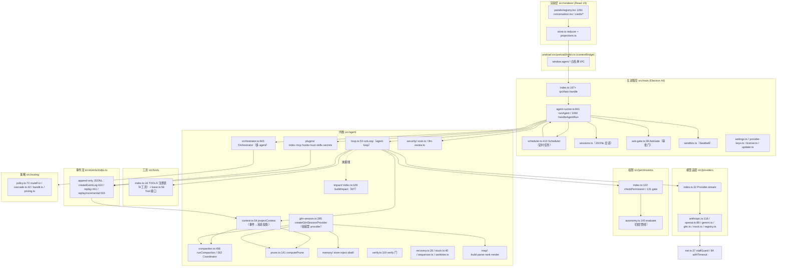
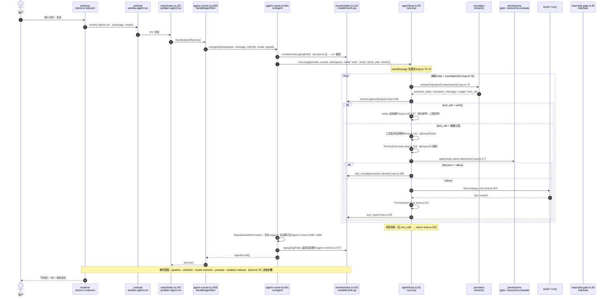

> **⚠️ 存档（2026-09-19 入库时追注，正文一字未改）**：本文「基线」行里的三个计数只对该日有效，
> 今天重跑全部不符——`src ≈ 2.6 万行`（今日 `find src -name "*.ts" -o -name "*.tsx" | xargs wc -l` 实测 **2.35 万**，
> React 树删除后缩水）、`pnpm gates` 道数与「测试 59 files / 554 passed」（今日现跑现取，
> **门数一律以 `scripts/gate-manifest.ts` 与 `pnpm gates` 输出为准，不写死**）。
> 其架构分层与 `file:line` 证据仍可读，但**所有行号引用前须重 grep**。
> **现权威两面**：意图 = `agent-plan.md` §10.1；事实 = `docs/ui-fact-baseline.md`（每项配复跑命令）。

# DSH 架构梳理与功能缺口分析报告

| 项 | 值 |
| --- | --- |
| 审查方 | 高见远（Gao）· 架构师 |
| 日期 | 2026-09-15 |
| 对象 | `/Users/ze/Downloads/deepseek harness`（DSH，Electron 桌面编程 Agent） |
| 范围 | 只读分析（未改动任何 src 代码）；M0–M6 已收口 + M7（影响面）开工中 |
| 方法 | 实读源码（Read/Grep/Glob），所有结论附 `file:line` 证据；推断项显式标「待证」 |
| 基线 | src ≈ 2.6 万行；`pnpm gates` 26 道门（`package.json` scripts）；测试 59 files / 554 passed |

> **阅读提示**：本报告分三部分——① 架构与模块清单（含分层图、一轮对话数据流）② 功能缺口清单（四维度、P0–P3 分级、逐条附证据）③ 完善方案（目标/接口/接入点/关系/验证）。第三部分优先复用项目已有机制（事件流、权限门、降级链、门禁脚本）。

---

## 第一部分 · 架构与核心模块清单

### 1.1 分层架构图

### 1.2 核心模块清单（职责 · 关键入口符号 · 上下游）

| 模块 | 职责（一句话） | 关键入口符号（file:line） | 上游依赖 | 下游被谁用 |
| --- | --- | --- | --- | --- |
| **events** | append-only JSONL 事件流：唯一事实源；重放/增量重放/分支 | `createEventLog` `src/events/index.ts:410`；`replay` `:441`；`replayIncremental` `:503`；`forkSession` `:589` | node:fs | 全体（loop/context/orchestrator/renderer） |
| **agent/loop** | agent loop：事件流→模型→工具→事件流；轮内交错 | `runLoop` `src/agent/loop.ts:53` | events / providers / permissions / tools / context | `runAgent`、`sidechat`、`orchestrator.runWorker` |
| **agent/context** | 事件列表→模型消息投影（纯函数、幂等、compaction 感知） | `projectContext` `src/agent/context.ts:54`；`excludedIds` `:43` | events | loop / compaction / glm-session / distill |
| **agent/compaction** | 阈值摘要压缩：双条件触发→切点三纪律→六段模板→三闸→降级链 | `runCompaction` `src/agent/compaction.ts:456`；`CompactionCoordinator` `:562`；`shouldCompact` `:100` | context / shape / events | glm-session（暗卷）、sidechat、orchestrator(worker)、handleCompact |
| **agent/prune** | 类型化裁剪（零 LLM）：保护区 40k/最小 20k/最近 2 轮免剪 | `computePrune` `src/agent/prune.ts:141`；`buildPruneIndex` `:92` | events | glm-session（暗卷）、演示通道 |
| **agent/memory** | 两层记忆（项目 .agent/ + 全局）：写入/注入/蒸馏 | `writeTopic` `memory/store.ts:251`；`buildMemoryInjection` `memory/inject.ts:163`；`runSessionEndDistill` `memory/distill.ts:40` | events / shape / tools | glm-session、sidechat、remember 工具、会话尾沉淀 |
| **agent/orchestrator** | 多 agent 编排：spawn/pipeline/supervise/worktree/审批/合并/卡死 | `Orchestrator` `src/agent/orchestrator.ts:643`；`spawn` `:739`；`spawnPipeline` `:1292`；`spawnSupervise` `:1341` | loop / events / worktree / sequencer / stuck / routing | agent-runner（会话级编排器） |
| **agent/verify** | 验证门：按仓库配置跑 lint/test，反射循环 | `runVerifyOutcome` `src/agent/verify.ts:119`；`createVerifyHook` `:151` | tools/process / events | loop（verify 分支）、agent-runner |
| **agent/recovery** | 崩溃恢复：扫无终态 worker→failed(interrupted)+重派参数 | `interruptedWorkers` `src/agent/recovery.ts:26` | events | `applyCrashRecovery` `agent-runner.ts:1555` |
| **agent/stuck** | 卡死检测：同动作同观察×4 / 同动作错×3 / 静默超时 | `detectStuck` `src/agent/stuck.ts:40` | 纯函数 | orchestrator |
| **agent/glm-session** | **组装型 provider**：事件日志→prune+compaction+记忆+地图→GLM 多轮 | `createGlmSessionProvider` `src/agent/glm-session.ts:285`；`composeTurnMessages` `:262` | events/context/prune/compaction/memory/map | **仅 gate-check 暗卷 + tests**（见缺口 C-1/T-2） |
| **agent/map** | 符号地图：tree-sitter 抽取→排名→预算内渲染 | `buildMap` `map/build.ts`；`scanSourceFiles` | tree-sitter | glm-session（首轮注入） |
| **agent/impact（M7）** | 跨文件影响面：def/ref 边 + {mtime,size} 增量 + 应用目录缓存 | `buildImpact` `impact/index.ts:109`；`fileImpact` `:250`；`defaultImpactHook` `:279` | map/parse、map/build | **未接线**（见缺口 I-1） |
| **agent/plugins** | 插件/MCP/hooks/skills/信任/密钥 | `PluginRuntime` `plugins/index.ts:109`；`McpManager` `plugins/mcp.ts:103`；`HookEngine` `plugins/hooks.ts` | net / events | agent-runner（会话启动装载） |
| **agent/security** | 产出代码安全：静态快筛（熵+危险 API 六类）+ LLM 二段 | `scan.ts:441`；`llm-review.ts:125` | events | `runSecurityReportHook` `agent-runner.ts:475` |
| **tools** | 9 工具注册表 + 统一 Tool 接口 + 路径信任边界 | `TOOLS` `src/tools/index.ts:16`；`Tool` `base.ts:56`；`resolveInWorkspace` `base.ts:64` | process / lsp | loop、sidechat、orchestrator(worker) |
| **permissions** | 权限门：方案门 + 档位 + 四层评估管线（规则/风险/沙箱） | `checkPermission` `permissions/index.ts:122`；`gate` `:131`；`evaluate` `autonomy.ts:140` | rules/risk | loop、gatedTool、orchestrator(worker) |
| **providers** | 模型适配：统一 `stream(messages,tools?)`，四家 + mock | `Provider` `providers/index.ts:32`；`streamAnthropic` `anthropic.ts:116`；`streamOpenAI` `openai.ts:89`；`streamGlm` `glm.ts:52` | net | loop / glm-session / distill / sidechat |
| **routing** | 策略层：档位表 + 纯函数路由 + 级联升级 + bandit | `routeFor` `routing/policy.ts:72`；`runCascade` `cascade.ts:42`；`selectArm` `bandit.ts` | providers/registry | orchestrator（worker 选档） |
| **net** | 出网设施：停滞看门狗（可续期）+ 一次性超时 | `stallGuard` `src/net.ts:37`；`withTimeout` `:84` | — | providers / mcp / updater |
| **main/agent-runner** | 主进程 agent 门面：runAgent/handleAgentRun/会话/记忆/插件/定时 | `runAgent` `agent-runner.ts:841`；`handleAgentRun` `:1092`；`handleCardAction` `:1147` | 内核全部 + main 子模块 | main/index IPC |
| **main/scheduler** | 定时任务：1min tick + journal + 三闸 + 无人值守 fail-closed | `Scheduler` `scheduler.ts:413`；`tick` `:505`；`appendJournalEntry` `:130` | agent-runner / events | main/index IPC |
| **main/sessions** | JSONL 会话 CRUD + sidechat 目录 | `listSessions` `sessions.ts:56`；`createSession` `:83`；`pathOf` `:106` | events | agent-runner |
| **main/ask-gate** | 审批门状态机：pending→approved/rejected，60s 超时拒绝 | `AskGate` `ask-gate.ts:39`；`request` `:55`；`decide` `:106` | permissions | agent-runner、gatedTool |
| **renderer** | 事件→UI：reducer 折叠 + 投影 + 面板/卡片 | `reducer` `store.ts:70`；`foldEvent` `:34`；`projectTokenUsage` `projections.ts:45`；`panels/registry.tsx` | preload / events | 用户界面 |

### 1.3 「一轮对话」完整数据流（含 file:line）

**关键机制注记**
- **权限门双入口**：`loop.ts:177` 的 `gate()` 用于主 loop；`agent-runner.ts:263 gatedTool` 用于写向工具（真实门，复用 `checkPermission`）；`autonomy.ts:140 evaluate` 是规则库/风险/沙箱四层管线。
- **审批挂起**：交互 run 走 `AskGate`（`agent-runner.ts:578 appAskGate`，60s 超时拒绝）；无人值守 run 走 `unattendedAskGate`（`agent-runner.ts:1088`，立即 fail-closed）。
- **事件旁路顺序**：每条事件**先落 JSONL 再回调**（`agent-runner.ts:880-883 pipeline`），保证磁盘即事实源。
- **run 级隔离**：`AsyncLocalStorage`（`agent-runner.ts:174 runScopeALS` + `permissions/index.ts:69 planScopeALS`）使并发 run（交互 vs 定时）各持独立会话态/plan 态。

---

## 第二部分 · 功能缺口清单

> 格式：**现象** ｜ **证据（file:line）** ｜ **影响** ｜ **严重度**。凡推断而非实证者标「待证」。

### 2.1 工具调用

| 编号 | 现象 | 证据（file:line） | 影响 | 严重度 |
| --- | --- | --- | --- | --- |
| **T-1** | **生产 loop 不把工具面交给模型**：`runLoop` 调 `streamFn(projectContext(seen))` 只传 messages，第二参 `tools` 恒 undefined；`Provider.stream(messages, tools?)` 的 tools 在主路径从未传入 | `loop.ts:64-67`（`(messages) => provider.stream(messages, undefined, …)`）、`loop.ts:79`；工具规格 `gateToolSpecs`（`glm-session.ts:30`）仅被 `gate-check.ts:233` 与 `sidechat` 使用 | 真模型在生产路径看不到工具 schema，无法发起工具调用（agentic 能力仅在 mock 剧本/暗卷可用） | **P1** |
| **T-2** | **生产真模型 provider 是「单轮、无工具、无结果回灌」演示通道**：`createProvider` 的 GLM 分支 `gen` 只建一次、从 `[prefix, userMessage]` 构建、**忽略入参 messages**、tools 传 undefined | `agent-runner.ts:797-827`（注释自陈「M1a 真流式演示通道…单轮流式（无 tools，纯文本）」）；生产组装逻辑在 `glm-session.ts:285`，仅 `gate-check.ts:233` + `tests/compaction.test.ts:413` 消费 | 生产真模型无多轮闭环、无工具结果回灌、无压缩/prune/记忆/地图；完整会话能力只活在验收暗卷路径 | **P0** |
| **T-3** | 并行工具调用不并发：loop 逐事件串行 `await tool.run`，模型一轮返回多个 tool_call 时顺序执行 | `loop.ts:79-232`（for-await 内逐个 await）；provider 侧已支持多 tool_call（`anthropic.ts:167` blocks Map、`openai.ts:165` pending Map） | 多工具轮次延迟叠加（无 `Promise.all`）；功能不缺，性能欠佳 | P2 |
| **T-4** | **工具结果无统一大小上限**：各工具自带上限（read 50KB `read_file.ts:7`、shell 32KB `run_shell.ts:5`、grep 100 命中 `grep.ts:5`、glob 100 `glob.ts:7`），但 **MCP 工具结果完全无截断** | `mcp.ts:191-200`（`parts.join("\n") || "(空结果)"`，无长度帽）；loop 侧 `tool_result` 无全局帽（`loop.ts:225`） | 超大 tool_result 直进事件流→投影→上下文；仅靠 prune 事后裁（且 prune 生产未接线，见 C-1） | P2 |
| **T-5** | **无失败重试**：providers 无 429/5xx/网络抖动重试；loop 无工具重试；仅 compaction 有 1 次退避重试 | 三家 provider 首包错误即抛（`openai.ts:127-131`、`anthropic.ts:150-154`）；`compaction.ts:528`（唯一重试点） | 瞬时网络/限流错误直接终结本轮（见 E-1） | P2 |
| **T-6** | 工具超时/取消覆盖不均：run_shell 60s、verify 60s、MCP connect 30s/call 120s、LSP request 8s；**MCP `callTool` 未接 `ctx.signal`**（只 `withTimeout`），120s 偏长 | `run_shell.ts:6`、`verify.ts:23`、`mcp.ts:13/17/186`、`lsp.ts:176`；loop 已透传 signal `loop.ts:200` | 取消 run 时 MCP 在途调用仍挂至 120s（与 D12「取消即收束」纪律不一致） | P2 |
| **T-7** | 工具发现静态：MCP `tools/list` 仅 connect 时拉一次，`onclose` 只标 failed，**无自动重连**；LSP 需 `.agent/lsp.json` 显式配置，无 server 自动发现 | `mcp.ts:137`、`mcp.ts:146-159`（注释明示「重连入口留位，本轮不自动重连」）、`lsp.ts:45-78` | server 崩溃后该 MCP 工具永久不可用（需重开会话）；LSP 未配置则无诊断 | P3 |

### 2.2 记忆管理

| 编号 | 现象 | 证据（file:line） | 影响 | 严重度 |
| --- | --- | --- | --- | --- |
| **M-1** | **生产主会话不注入记忆**：`buildMemoryInjection` 仅被 `glm-session.ts:365`（暗卷）与 `sidechat.ts:255` 调用；生产 `runAgent` 路径不注入 | `inject.ts:163` 定义；调用点 `glm-session.ts:365`、`sidechat.ts:255`（grep 全仓仅此二处） | 生产真模型看不到跨会话记忆（同 T-2 根因） | **P1** |
| **M-2** | **无容量上限/淘汰**：topic 文件无单文件大小帽（`writeTopic` 只查索引上限），无总容量、无 TTL、无 LRU 淘汰 | `store.ts:251-275`（仅 `checkIndexLimit` 于 `:262`）；索引硬上限 200 行/25KB `store.ts:22-23` | 长期使用 topic 正文无界增长（磁盘）；注入侧靠预算整行丢弃（`inject.ts:192`）兜底，但磁盘不回收 | P2 |
| **M-3** | 检索为「固定回注名单」，**无按需语义检索**：只回注 ARCHITECTURE（>4KB 只注大纲）/DECISIONS 最近 20/MEMORY.md 索引 | `inject.ts:163-209`；`MEMORY_TOKEN_BUDGET_DEFAULT=6000` `inject.ts:21` | 大量 topic 正文需模型显式 `read_file` 才能读到；无关键词/向量召回，命中率靠模型自觉 | P2 |
| **M-4** | 并发一致性：写入已按文件键串行（`serializeOn` `store.ts:156`），索引 tmp→rename 原子（`store.ts:269-272`）；但 `external-refs.json` 与 topic 索引分属不同锁键，跨文件无事务 | `store.ts:169-181`（external-refs 串行）、`store.ts:251-275`（topic 串行） | 单文件内一致（已收口）；跨文件无跨实体一致性（影响面小） | P3 |
| **M-5** | 蒸馏仅在会话结束触发，且仅非 read-only、非 unattended；失败只 `console.warn` | `agent-runner.ts:1038`（`autoMemory && mode!=="read-only" && unattended!==true`）、`distill.ts:40`、`agent-runner.ts:1058` | 长会话中途无沉淀；蒸馏失败无事件记录（静默） | P3 |

### 2.3 多轮对话

| 编号 | 现象 | 证据（file:line） | 影响 | 严重度 |
| --- | --- | --- | --- | --- |
| **C-1** | **生产主会话不自动压缩/裁剪**：`maybeCompact`/`computePrune` 只在 `glm-session.ts`（暗卷）、`sidechat`、`orchestrator`(worker) 出现；生产 `runAgent` 路径无调用 | grep 全仓：`runCompaction` 调用点 = `glm-session.ts:378`(coordinator)、`sidechat.ts:86`、`orchestrator.ts:2789`、`agent-runner.ts:453`(handleCompact 手动)、`agent-runner.ts:1003`(演示通道)；`computePrune` = `glm-session.ts:322`、`agent-runner.ts:1017`(演示) | 真模型长会话无上下文治理；压缩/prune 机制**存在但不在生产热路径** | **P0** |
| **C-2** | 崩溃恢复只覆盖 **worker**：`interruptedWorkers` 扫 `agent_spawned` 无终态者，主会话 run 崩溃无「半截 turn」恢复语义 | `recovery.ts:26`、`agent-runner.ts:1555 applyCrashRecovery` | 主会话进程崩溃后重启：replay 容忍尾部坏行（`events/index.ts:464`）但无 turn 级重建/重放提示 | P1 |
| **C-3** | 会话持久化 = append-only JSONL，中段坏行 **fail-loud**（不静默跳过），但**无修复工具**、无 journal/checkpoint | `events/index.ts:441-478`（中段坏行抛错 `:465`） | 正确但不可恢复：文件真损坏时用户只能「修复文件或从备份恢复」（无 `--repair` 入口） | P2 |
| **C-4** | 上下文预算/token 核算仅在压缩路径使用；生产路径无预算核算（因不组装） | `estimateTokens` `compaction.ts:43`、`calibrateFactor` `:48`、`estimateContextTokens` `:81`；调用点集中在压缩/组装 | 无「当前轮 token 预算」可见面；无成本闸对主会话生效（成本闸仅 orchestrator worker，`orchestrator.ts:660`） | P2 |

### 2.4 错误处理

| 编号 | 现象 | 证据（file:line） | 影响 | 严重度 |
| --- | --- | --- | --- | --- |
| **E-1** | **模型/网络错误无事件化**：`loop.ts:79` for-await 无 try/catch；provider 抛错（HTTP 非 2xx、SSE 帧损坏、流 error）直接冒泡出 `runLoop`→`runAgent`→`handleAgentRun` catch 返回 `{ok:false,error}`；**AgentEvent 无 error 类型** | `loop.ts:79`（无 catch）；`openai.ts:130/195/199`、`anthropic.ts:153/247/216`；`agent-runner.ts:1122-1124`；`events/index.ts:347-373`（union 无 error） | 事件流中**看不到失败**，renderer 静默、日志戛然而止；用户无诊断信息（最严重可用性缺口） | **P0** |
| **E-2** | 降级链只在压缩/路由/地图层：compaction→overflow 截断、routing→fallback、map→静默降级；**模型错误无降级**（无 provider 切换、无重试） | `compaction.ts:469-486`（overflow 兜底）、`policy.ts:63-69`（fallbackOrder）、`map/build.ts`（静默）；providers 无 fallback | 单 provider 故障 = 任务失败（无跨 provider 降级） | P1 |
| **E-3** | 静默降级面较多且**无事件记录**：hooks 引擎故障 `console.warn` 继续、插件装载失败静默零插件降级、地图/prune 失败静默 | `loop.ts:169-172`、`loop.ts:221-224`、`agent-runner.ts:911-913`、`glm-session.ts:324-326/398-400` | 属有意可用性取舍（fail-open），但故障不可审计、不可观测 | P2 |
| **E-4** | SSE 半帧静默丢字——**已修**：非 `{` 开头载荷容忍、真帧解析失败抛错 | `openai.ts:193-196`、`anthropic.ts:245-248`（H4 波1 1.6 收口） | 已收口，记录为「已解决」防回退 | ✅ 已解决 |
| **E-5** | 网络/SSE 中断无**续传**：`stallGuard` 静默窗 60s 覆盖三家 provider，但中断后无 resume/last-event-id 重连续传 | `net.ts:19/37`；providers 无 `Last-Event-ID` 逻辑 | 长流中断后整轮重来（重复计费/重复工具副作用） | P2 |
| **E-6** | fail-open vs fail-closed 纪律总体正确（权限 fail-closed、verify fail-closed、impact 计划 fail-loud、无人值守 fail-closed），**仅缺统一「错误即事件」纪律** | 正面：`permissions/index.ts:131`、`verify.ts:122`、`agent-runner.ts:1088`；缺口：E-1 | 纪律不一致：门/校验 fail-closed，但模型/工具/网络错误无结构化落流 | P2 |

---

## 第三部分 · 功能完善方案（可落地，复用既有机制）

> 原则：**优先复用**事件流（新事件类型 + KNOWN_TYPES 扩集）、权限门、降级链、门禁脚本（`scripts/*-check.ts` + `gate-manifest.ts`）；**禁止过度设计**（不引入新框架、不改只读 providers 契约）。每条给：目标 → 接口形态 → 接入点 → 关系 → 验证。

### 方案 A · 生产会话接线（覆盖 T-1 / T-2 / M-1 / C-1）— 最高优先级

| 项 | 内容 |
| --- | --- |
| **目标** | 让生产真模型 run 走「组装型 provider」：多轮 + 工具面 + 结果回灌 + prune + compaction + 记忆 + 地图 |
| **接口形态** | 复用既有 `createGlmSessionProvider(logPath, { system, tools: gateToolSpecs(mode), compaction:{ summarizer }, workspace, plugins })`（`glm-session.ts:285`）。**无需新接口**——该函数已实现全部所需能力 |
| **接入点** | `agent-runner.ts:797 createProvider`：当 `M0A_PROVIDER==="glm"` 时改为返回 `createGlmSessionProvider(opts.logPath, …)`（当前返回的是单轮演示 provider）。`tools` 传 `gateToolSpecs(opts.mode)`；`compaction.summarizer` 用既有 `createGlmSummarizer()`（`M0_API_KEY` 在场时，同 `agent-runner.ts:192` workerSummarizer 口径） |
| **与现有机制关系** | **复用**：provider 契约不变（`stream(messages,tools?)`）；loop 的 tools 第二参需在 `loop.ts:64-67` 补传（当前硬编码 `undefined`）——但注意 `createGlmSessionProvider` 忽略入参、以日志为事实源（`glm-session.ts:350-357`），故 **tools 由构造 opts 提供即可，loop 无需改**；与 `gate-check.ts:233` 暗卷路径**同源**，等价于把暗卷路径提升为生产路径 |
| **验证方式** | ① `pnpm e2e`（mock 剧本）行为字节不变（mock 分支不动）；② 新增 `tests/session-wiring.test.ts`：断言 `M0A_PROVIDER=glm` 时 `runAgent` 用的 provider 具备多轮（连续 `stream` 调用返回非空）+ 工具结果回灌（第二次 `stream` 的 messages 含前轮 `tool_result`）；③ `M0_API_KEY` 在场时跑 `pnpm gate-check`（暗卷）+ 一次真实多轮手动冒烟 |

> ⚠️ **落地前须与 team-lead 确认设计意图**：当前「单轮演示 provider」可能是有意的 M0 边界（AGENTS.md 未明确生产接线状态）。若确为有意留位，本项降级为「文档化缺口」而非缺陷。

### 方案 B · 错误即事件（覆盖 E-1 / E-2 / E-5）

| 项 | 内容 |
| --- | --- |
| **目标** | 模型/网络/工具错误结构化落流，UI 可见、可诊断；单 provider 故障可降级 |
| **接口形态** | 新增事件类型 `AgentErrorEvent { type:"error"; scope:"model"\|"tool"\|"network"\|"internal"; message:string; retryable:boolean; provider?:string; callId?:string }`；扩 `KNOWN_TYPES`（`events/index.ts:375`）+ `AgentEvent` union（`:347`）。renderer 加渲染分支（`store.ts:34 foldEvent` / `panels`） |
| **接入点** | ① `loop.ts:79` 包 try/catch：捕获 provider 抛错 → `events.append({type:"error",scope:"model",retryable:isRetryable(err),…})` → 再抛（保留现有 `{ok:false}` 语义）；② `loop.ts:202-206` 工具 catch 已在，补一条 `type:"error",scope:"tool"` 事件（或复用 tool_result + 新字段）；③ providers 内 `stallGuard` 停滞（`net.ts:74 stalled()`）映射 `scope:"network", retryable:true` |
| **与现有机制关系** | **复用**事件流（增量类型，旧日志重放逐字不变，与 M4a 三事件同族）；**复用** `stallGuard` 的 `stalled()` 区分停滞/对端报错（`net.ts:29`）；降级链复用 `policy.ts` 的 `fallbackOrder` 思路做 provider 级 fallback |
| **验证方式** | ① `tests/providers.test.ts` 增：mock fetch 抛 HTTP 500 → 断言事件流含 `type:"error"`；② `tests/events.test.ts`：`error` 进 KNOWN_TYPES + replay 旧日志（无 error）逐字不变；③ 断言体检门（`gates` 内置）无恒真式；④ 反向验证：摘掉 catch → 断言红 |

### 方案 C · 工具结果大小上限 + MCP 结果截断（覆盖 T-4 / T-6）

| 项 | 内容 |
| --- | --- |
| **目标** | 所有 `tool_result` 有界；MCP 结果不炸上下文；MCP 调用可随 run 取消 |
| **接口形态** | 复用既有 `truncationNotice(limitKB)`（`tools/base.ts:138`）。`mcp.ts:182 callTool` 加结果帽常量 `DEFAULT_MCP_RESULT_CHARS`（建议 32KB，对齐 shell/verify）+ 超帽截断提示；`callTool` 增 `signal?: AbortSignal` 形参，内部 `withTimeout` 与 signal 用 `AbortSignal.any` 合并（同 `openai.ts:121` 口径） |
| **接入点** | `mcp.ts:186-190`（withTimeout 合并 signal）；`mcp.ts:200`（结果截断）；`agent-runner.ts:327 gatedMcpTool` 把 `ctx.signal` 透传进 `callTool`（当前未传） |
| **与现有机制关系** | **复用** `withTimeout`（`net.ts:84`）+ `AbortSignal.any` 合并范式（providers 已用）+ `truncationNotice`；与 D12「取消即收束」纪律一致 |
| **验证方式** | ① `tests/plugins-mcp.test.ts` 增：注入超长 MCP 结果 → 断言 ≤ 帽 + 含截断提示；② 断言 `callTool` 传 abort signal 后在途 rejected；③ `plugins-check` 增断言；④ 反向验证：摘掉截断 → 断言红 |

### 方案 D · 记忆容量治理 + 按需检索（覆盖 M-2 / M-3）

| 项 | 内容 |
| --- | --- |
| **目标** | 记忆磁盘有界；模型可主动按名/关键词检索 topic |
| **接口形态** | ① `store.ts` 增 `MEMORY_TOPIC_MAX_BYTES`（建议 64KB）与 `pruneTopics(dir, {maxTotalBytes})`（LRU by `modified`，**只提示不自动删**，与「模型无删除权」纪律一致：超限返回 `index_overflow` 类错误要求模型合并）；② 新增只读工具 `recall_memory({ query })` 或复用 `grep` 语义（对 `.agent/memory/*.md` 关键词检索返回索引行），注册进 `TOOLS`（`tools/index.ts:16`） |
| **接入点** | `store.ts:109 checkIndexLimit` 旁增 topic 体积检查（写入口收敛）；`tools/index.ts:16` 注册；`glm-session.ts:30 gateToolSpecs` 增工具规格 |
| **与现有机制关系** | **复用**写入口收敛（`store.ts` 是唯一知道布局处）+ 硬上限「写入端拒绝、不静默截断」纪律（`store.ts:109-118`）；**复用** `escapeControlTags` 安全件（`inject.ts:38`）作用于新工具输出 |
| **验证方式** | ① `tests/store.test.ts` 增：超 topic 帽 → `index_overflow` 且不落盘；② `memory-check` 增断言；③ 反向验证：去掉帽 → 断言红 |

### 方案 E · 主会话崩溃恢复（覆盖 C-2）

| 项 | 内容 |
| --- | --- |
| **目标** | 主会话 run 崩溃后重启，能识别「半截 turn」并给恢复提示 |
| **接口形态** | 复用纯投影模式（同 `recovery.ts`）：新增 `danglingTurn(events): { lastEventId:number; lastRole:string } | null`（末条非终态：无 assistant_message 收尾 / 有 tool_call 无对应 tool_result）；事件层复用 `agent_message` 或新增轻量 `session_meta` 注记 |
| **接入点** | `recovery.ts`（新增纯函数）+ `agent-runner.ts:1555 applyCrashRecovery` 调用点扩展（现只处理 worker）；`handleSessionOpen`（`agent-runner.ts:1544`）重放后调用 |
| **与现有机制关系** | **复用** `replay`（尾部坏行容忍 `events/index.ts:464`）+ `interruptedWorkers` 同款「扫描→补事件」模式；**不新增**持久化格式 |
| **验证方式** | ① `tests/recovery.test.ts` 增：构造半截 turn 事件序列 → 断言 `danglingTurn` 非空；② 幂等断言（补注后重扫不再触发）；③ 反向验证：去掉扫描 → 断言红 |

### 方案 F · M7 影响面接线（覆盖 I-1）

| 项 | 内容 |
| --- | --- |
| **目标** | 每次 write_file/edit_file 成功后算影响面并落 `impact_report` 事件 + 回注模型 |
| **接口形态** | **已定义**：`ImpactHook` 类型（`impact/index.ts:275`）、`defaultImpactHook(workspace, cacheDir)`（`:279`）、`ImpactReportEvent`（`events/index.ts:152`，已在 KNOWN_TYPES `:389`） |
| **接入点** | `loop.ts` 增 `LoopOptions.impact?: ImpactHook`；在 `tool_result` 落流后、当 `output.name` ∈ {write_file, edit_file} 且 `result.ok` 时调用：`const r = await opts.impact(path)` → 非 null 则 `events.append(r.event)` 并把 `r.contextNote` 追加进 tool_result 尾部（同 PostToolUse `additionalContext` 口径 `loop.ts:220`）；`agent-runner.ts:952 runLoop(...)` 传入 `impact: defaultImpactHook(opts.workspace)` |
| **与现有机制关系** | **复用** `verify.ts` 的 `ExecFn` 注入范式（`impact/index.ts:273` 注释自陈同族）；**复用** PostToolUse 的 contextNote 回注通道；fail-safe：hook 抛错 → `console.debug` 跳过、loop 继续（同 prune/地图降级纪律）；**注意** `ImpactUnavailableError`（`:16`）文案含 `unavailable`，按计划应 fail-loud——建议 loop 侧捕获后落 `type:"error",scope:"internal"`（方案 B）而非静默 |
| **验证方式** | ① `scripts/impact-check.ts`（M7 计划任务 4）：mini-repo 冻结判卷定死调用集；② `tests/impact.test.ts`：写文件后事件流含 `impact_report`；③ 反向验证：去掉 hook 接线 → 断言红；④ `gate-manifest.ts` 登记新门 |

### 方案优先级与依赖

| 方案 | 覆盖缺口 | 优先级 | 依赖 | 预估改动面 |
| --- | --- | --- | --- | --- |
| A 生产会话接线 | T-1/T-2/M-1/C-1 | **P0**（须先确认设计意图） | — | `agent-runner.ts` 1 处 + 测试 |
| B 错误即事件 | E-1/E-2/E-5 | **P0** | — | `events` + `loop.ts` + renderer 各 1 处 |
| C MCP 结果帽+取消 | T-4/T-6 | P1 | — | `mcp.ts` + `agent-runner.ts` |
| D 记忆容量+检索 | M-2/M-3 | P2 | — | `store.ts` + 新工具 |
| E 主会话崩溃恢复 | C-2 | P2 | — | `recovery.ts` + `agent-runner.ts` |
| F M7 影响面接线 | I-1 | P1（M7 计划内） | — | `loop.ts` + `agent-runner.ts` + 新门 |

---

## 附 · 关键发现摘要（TL;DR）

1. **架构本质**：事件流（append-only JSONL）是唯一事实源；`projectContext` 是纯投影；权限门双入口（loop `gate` + `gatedTool`）；三层降级纪律（compaction→overflow / routing→fallback / 地图→静默）。设计高度模块化、纪律严明（fail-closed 面清晰）。
2. **最严重缺口（P0×2）**：
   - **T-2/C-1**：生产真模型路径用的是「单轮、无工具、无结果回灌」演示 provider（`agent-runner.ts:797`），而承载压缩/prune/记忆/地图的组装型 provider（`glm-session.ts:285`）**仅接在验收暗卷路径**——完整 agentic 会话能力未上生产热路径。
   - **E-1**：模型/网络错误**无事件化**（`loop.ts:79` 无 catch，AgentEvent 无 error 类型），UI 静默、日志戛然而止。
3. **中等缺口（P1）**：T-1（loop 不传工具面）、M-1（生产不注入记忆）、E-2（无 provider 降级）、C-2（主会话无崩溃恢复）、F/I-1（M7 影响面已实现但未接线，`impact_report` 事件类型已就绪）。
4. **值得肯定**：H4 波次已收口的并发/半帧/跨会话归因等硬问题（`replayChain`、SSE 帧分流、`foldsIntoCurrentSession`）**质量高**；门禁体系（26 道 + 清单漂移校验 + 恒真式体检）是同类项目中的强项，应作为新功能的验证基座复用。

> 本报告全部结论基于实读源码；唯一需人工确认的推断项为 **方案 A 的设计意图**（单轮 provider 是否有意留位）与 **T-2 的生产路径判定**，已在对应条目标注。
