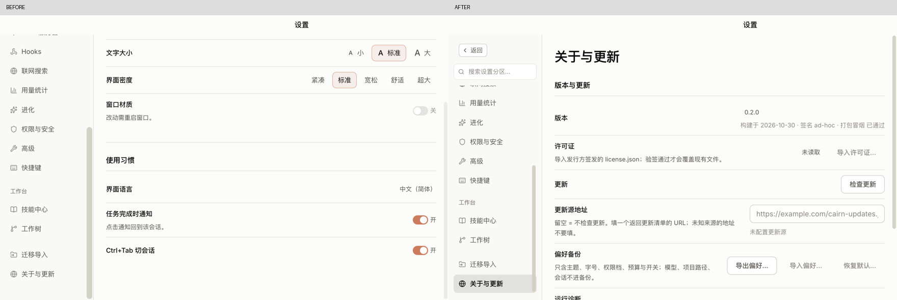

# 桌面端操作体验与布局优化

2026-11-07。工作树 `/Users/ze/Downloads/Cairn/cairn`，分支 `fix/spec-summary-double-count`，HEAD `fc6e3638`。改动未提交，保留其他会话已有修改。用户选择优先优化操作体验与布局。

本轮先用当前源码构建 Electron renderer，捕获并检查首页、会话、检查器、设置各分区、插件、记忆、自动化和决策卡的 41 个不同界面状态，再集中修复设置导航路径中的 6 类问题。广域捕获无导航入口遗漏、无重复截图、无页面错误，见 [原始检查](before/checks.json)；这不代表所有按钮与后端行为均已验收。

## 已修复

| 优先级 | 原问题与影响 | 当前行为 |
| --- | --- | --- |
| P2 | 搜索 ref 未接到输入框，初始焦点落到返回；点清空后焦点丢失 | 打开设置和清空后均聚焦搜索，可以继续键入 |
| P2 | ModalSurface 的捕获阶段截走 Esc，输入框的清空逻辑无法执行 | 搜索有字时 Esc 清空，空查询时先离开搜索，再次 Esc 关闭；组字期间不消费 Esc |
| P2 | 搜索下键只切内容、不移焦；分区列表没有方向键操作 | 搜索 Enter／下键激活首项，上键激活末项并移焦；列表支持上下键、Home／End，Enter 激活；移动焦点不会误切正文 |
| P2 | 切分区保留上页滚动位置，标题与首项在视口外 | 正文切换时在绘制前回顶；实测从 `187.5px` 恢复到 `0px` |
| P2 | 短窗滚动整列导航后，返回和搜索离开视口 | 顶部返回与搜索保留，分区列表独立滚动；880×560 下可到达最后一项 |
| P2 | 清空按钮仅 16×16px，难以点中 | 点击区域扩大到 28×28px，保持现有控件风格 |

保留当前配色、文字层级与设置分区。复用现有 `menuNavIndex` 和 ModalSurface，没有新增依赖或替换弹层系统。可取消的 Esc 回调沿用 [Radix 的处理约定](https://www.radix-ui.com/primitives/docs/components/dialog)，焦点与滚动通过 [React DOM ref](https://react.dev/learn/manipulating-the-dom-with-refs) 管理。

未保存个性化草稿仍进入确认框；确认框 Esc 仅回到编辑并保留草稿和焦点。普通设置字段的失焦保存、返回直接关闭及背景隔离均保留。

## 截图与步骤

1. 打开设置 → 搜索 → 清空／Esc：[修改后搜索状态](final/01-search-escape.png)。焦点与键盘行为以运行时断言为准，截图本身不能证明焦点归属。
2. 在较长分区滚到底部 → 切换高级：[修改后标题和首项](final/02-section-start.png)。
3. 缩到 880×560 → 导航 End → Enter：[修改前](before-navigation/03-short-light.png)／[修改后](final/03-short-light.png)。两张图执行相同按键序列；原实现 End 未导航、Enter 激活了旧焦点，因此正文也不同。
4. 窄窗深色搜索：[修改后](final/04-short-dark.png)。搜索筛选分区名与同义词；正文仍由用户选择分区后打开。

其余基线界面概览：[1](before/overview-1.jpg)、[2](before/overview-2.jpg)、[3](before/overview-3.jpg)、[4](before/overview-4.jpg)。原始 PNG 与这些总览保存在同一目录。截图显示现有浅深主题与主导航保持一致；未由截图推断网络、Provider 或安全能力已经可用。

## 验证

| 检查 | 结果 | 证据 |
| --- | --- | --- |
| 当前 renderer 的设置导航与布局 | 24/24 通过，控制台错误 0 | [最终断言](final/checks.json) |
| Esc／返回关闭前保存编辑值 | 7/7 通过，重新打开可见保存值 | [断言](esc-regression/checks.json) |
| 桌面 Vitest，`--maxWorkers=2` | 331 文件、2,284 项通过 | [日志](desktop-capped.log) |
| `node --import tsx scripts/typecheck.ts` | exit 0 | [日志](typecheck.log) |
| renderer layering / desktop boundary | 均通过 | [分层](renderer-layer.log)、[边界](boundary.log) |
| 文档规则检查 | 受检项全绿 | [日志](docs-check.log) |
| 当前 renderer Vite 构建 | 通过 | [日志](build.log) |
| 设计 detector（仅三个修改的 UI 文件） | 返回 `[]` | [结果](detector.json) |
| 新脚本语法 / 本轮限定路径 diff 空白检查 | 通过 | `node --check` / `git diff --check` |

最终桌面命令为 `pnpm --filter cairn-desktop exec vitest run --config vitest.config.ts --maxWorkers=2`。边界检查另行执行。前一轮完整桌面运行遇到 1 条旧源码形状断言失败：IME 守卫由条件内部移到条件之前；已同步为包含守卫及相邻分支的断言，并保留真实 renderer 的组字回车检查，没有移除或放宽组字要求。见 [首次桌面日志](desktop-tests.log)。

原始实现的导航失败记录见 [before-navigation](before-navigation/checks.json)。早期探针有两项需要校正：1440×900 的关于页不溢出，故滚动复现改用 880×560；合成组字 KeyboardEvent 必须设置 `cancelable:true` 才能模拟真实按键的 `preventDefault()`。未把这些驱动前提错误计作产品问题；原始红测中的合成组字 Esc 读数不作为单独证据。

## 审查与范围

本代理按 OCR delegate 模式完成审查：先执行有 `--exclude` 限定的 preview，再为本轮文件读取规则；未执行 `ocr review` 或 `ocr scan`。见 [文件选择](review-preview.txt)、[规则](review-rules.txt)。审查针对 [本轮产品增量](task.patch)，同时检查新增 Electron 脚本与两项源码断言更新；未发现剩余需修复问题。审查由实现者本人完成，没有独立审查者。

仓库不存在 `.codegraph/` 索引，按用户规则跳过 CodeGraph，使用 `rg` 与定点读取。没有创建索引、安装工具或更改项目／全局规则。

运行时检查使用真实 Electron renderer、合成 AgentApi 和临时用户目录，不写实际用户设置、不调用 Provider。组字检查覆盖事件标志，未验证所有系统输入法。截图与断言不构成完整读屏或 WCAG 合规认证；未做本轮性能基准。没有运行完整核心 gates、HEAD 认证或 mutation，没有打包或发布；证据适用于当前工作树，不代表提交态或发布态验收。
