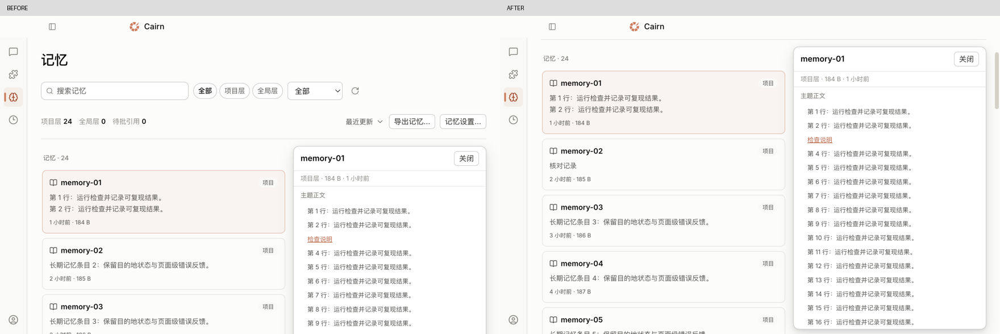
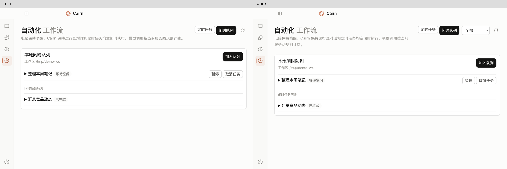

# 桌面体验持续优化：记忆、浏览器与筛选

2026-11-07，`fix/spec-summary-double-count`，HEAD `fc6e3638`。在共享工作树上继续上一轮设置优化；本轮产物与代码未提交。四次检查分别覆盖右栏与详情、筛选入口、键盘阅读与过期详情、卡片焦点。每轮以 Electron 可复现行为决定是否修改。

## 参考设计与采用范围

| 参考 | 观察 | Cairn 采用的做法 |
| --- | --- | --- |
| [DeepSeek Harness · 右栏设计](https://github.com/deepseek-ai/deepseek-harness/blob/master/docs/subsystems/sidebar-right.md)（[MIT](https://github.com/deepseek-ai/deepseek-harness/blob/master/LICENSE)） | 打开内容时同时确保对应窗格可见；支持保留已访问的内容体 | 记忆正文链接打开可见工作台，回记忆时保留详情；继续使用现有窗格，不引入 DockKit |
| [Tianshu Harness · 桌面工作台说明](https://tianshuharness.com/)（[Apache-2.0 源仓](https://github.com/huiliyi37/Tianshu-harness)） | 官方说明把保留会话、项目与配置和集中管理自动化作为工作台能力 | 优先保留阅读位置与筛选选择，把闲时任务筛选限制在当前队列，已完成历史保持可见 |

参考的是公开设计文档与产品说明。未安装或运行对标项目，没有复制其代码、资产或引入依赖。

## 问题与修复

| 原问题 | 修改后 |
| --- | --- |
| 880×560 打开长记忆时详情底部达到约 1975px，外层页面承担全部滚动 | 详情限高，正文独立滚动；标题和关闭按钮保持可见，最终实测底部 552px |
| 打开详情焦点留在原卡片，关闭后焦点丢失 | 打开聚焦关闭，Tab 可到正文，PageDown 可读长文；Esc 或点击关闭回到原卡片 |
| 搜索排除当前记录后仍显示旧正文和动作 | 详情与筛选结果一致，清空搜索不会自动重开旧详情 |
| 预览卡包含可聚焦链接，Tab 停在卡片内部 | 卡片用原生按钮，预览保留链接文字；可操作链接只在详情正文内 |
| 记忆链接进入隐藏的会话窗格；切回记忆未通知浏览视图让位 | 点击链接显示对应浏览器窗格；离开工作台时发零尺寸通知，返回记忆保留详情 |
| 宽窗上下文栏与页头重复展示筛选，窄窗可能同时出现标签和下拉 | 上下文栏可见时它是筛选入口；窄窗和紧凑工具栏使用单一控件，保留所选筛选 |
| 窄窗闲时队列没有筛选入口 | 复用自动化页筛选；筛选队列不隐藏已完成历史 |

核对了 880px 检查器和文件窗格的显式开合：原行为已能显示，收起再显示也保留窗格内容；本轮没有改写右栏的响应式尺寸策略。

## 实测路径与截图

1. 打开记忆 → 键盘打开 60 行正文 → 滚到底 → Esc：[原始状态](baseline/03-memory-open-880.png)、[最终滚到末尾](delivery/04-memory-end-880.png)、[深色窄窗](delivery/07-memory-dark-880.png)。
2. 点击正文链接 → 浏览器打开正确地址 → 回记忆：检查 renderer 发送可见矩形，返回后发送零矩形，原详情继续存在。见 [运行读数](delivery/checks.json)。
3. 宽窗从上下文栏选项目层 → 缩窄 → 切到闲时队列筛选：[宽窗记忆](delivery/05-memory-filter-wide.png)、[闲时队列](delivery/06-idle-filter-880.png)。

## 验证与边界

| 检查 | 结果 |
| --- | --- |
| 新增工作台路径 Electron 冒烟 | [24/24](delivery/checks.json)，无 renderer 控制台错误 |
| 原有应用外壳 | [51/51](app-shell-final/checks.json) |
| 原有窗格与设置导航 | [15/15](pane-tabs/checks.json) 与 [24/24](settings-navigation/checks.json) |
| 全量桌面 Vitest，`--maxWorkers=2` | [331 文件，2,286 项通过](desktop-final.log) |
| Vite 构建、TypeScript、desktop boundary | [构建](final-build.log)、[类型](typecheck-final.log)、[边界](boundary.log)通过 |
| renderer layering | [未通过](renderer-layer-final.log)：本轮未修改的 `state/workbench.ts` 为 1202 行，超过 1200 上限 |
| 设计 detector | [两条既有警告](detector-final.json)：`styles.css` 161／176 行的侧栏宽度动画；没有新增发现 |

原始版本在同一路径中 [7/18 通过](baseline/checks.json)。后续补查分别让 [正文键盘滚动与过期详情](keyboard-and-filter-baseline/checks.json)、[预览卡焦点](card-keyboard-baseline/checks.json) 在修复前失败，最终与原用例一起通过。首轮全量另有既有 `kernel-host.test.ts` 启动失败用例超时；共享工作树的这项用例随后有并行修改，本轮未改动该用例或主进程，最终全量通过。保留 [首次日志](desktop-tests.log)、[独立复跑日志](kernel-host-recheck.log)和[中间版本断言](kernel-host-current.log)。

通过 `ocr delegate preview --exclude` 选择范围，由本代理读规则并审查本轮增量；未运行模型审查命令。见 [文件清单](review-preview.txt)、[规则](review-rules.txt)、[Markdown 规则](review-markdown-rule.txt)。`.codegraph/` 不存在，按规则使用定点读取。没有调整或绕过分层门槛。

证据来自真实 Electron renderer、隔离用户目录和合成 AgentApi。浏览器验证覆盖界面与 IPC 矩形通知，未实测原生网页渲染、生产 Provider、读屏全流程或跨平台打包。未提交、推送或发布。
