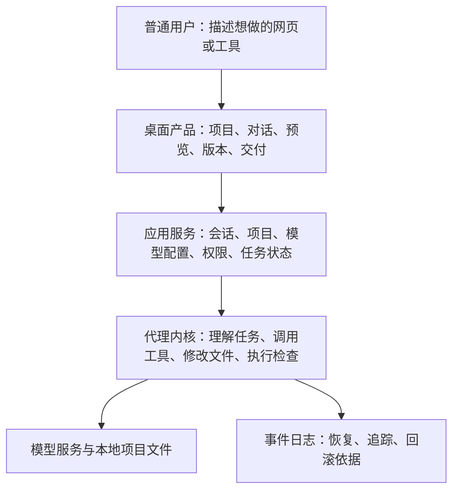

# Cairn 产品现状与完善方案

日期：2026-10-15（北京时间）。分析基线：分支 `fix/spec-summary-double-count`，HEAD `d7fe85563edeb2064ba2d88a2b03fe3f5ace5766`，以及本轮读取时的未提交工作区。

用户已确认的方向：面向不太懂代码的人，让他们通过自然语言制作网页、小工具，并修改已有项目。

**核心判断：项目已经有可复用的执行内核和桌面基础，接下来最有价值的工作是把需求、生成、运行预览、持续修改、检查和交付连成普通人能独立走通的产品流程。**

本文件是分析与建议稿。现状事实、历史证据、建议目标分别标注；排期属于估算。它不代表下述功能已经实现，也不改变仓库已有范围裁决。

**一、先弄清楚：我们现在到底有什么**

可以把 Cairn 理解成三层：

底层负责“能不能干活”，上层负责“用户能不能顺利把活做完”。现有仓库在前者上已有较多投入，后者仍需要围绕新受众形成明确的交付标准。

| 能力 | 本轮看到的现状 | 对新产品的价值 | 当前不能据此推断的事 |
|---|---|---|---|
| 代理执行 | 有读写文件、补丁、命令、搜索、计划、澄清、验证等工具链 | 能承担网页和小工具的生成、修改 | 任意用户任务都能成功 |
| 模型接入 | 有四类内置适配器、OpenAI 兼容通道和自定义供应商接入 | 可保留用户自带模型服务的路径 | 普通人能独立配好模型；所有模型适配质量相同 |
| 任务与会话 | 有事件日志、会话管理、取消、发送队列和多工作区处理 | 能支持持续修改与任务恢复 | 任意中断点都能恢复到用户预期状态 |
| 权限和文件保护 | 有权限分档、审批、路径边界、快照与撤回相关逻辑 | 用户敢把真实项目交给产品的基础 | 所有平台、所有执行路径都具有相同保护强度 |
| 桌面端 | Electron + React；有设置、项目导航、交付摘要、变更、文件、终端、浏览器等界面 | 产品壳已有基础，可继续完善 | 已形成面向普通用户的安装与使用体验 |
| 浏览器窗格 | 主进程使用 WebContentsView；渲染层可输入 URL 导航 | 能作为生成网页的预览载体 | 自动管理项目依赖、开发服务器和功能验收已经完成 |
| 新建项目 | 已核对的服务负责校验项目名并创建文件夹 | 已有项目存放入口 | 点击新建后即可得到可运行的网站模板 |
| 交付摘要 | 已按“改了什么、验证了什么、哪些未验证、下一步”表达结果 | 方向正确，可以继续面向普通人翻译 | 用户已能看到可操作的成品和分享出口 |
| 扩展能力 | 有插件、技能、记忆、调度与自进化相关实现 | 可作为后续进阶能力 | 它们应该成为新用户的首屏重点 |
| 工程质量 | 有核心测试、桌面测试、类型检查、34 道门及 25 道认证门 | 后续产品化可以建立在现有质量机制上 | 测试数量能替代用户任务完成率 |

主要代码入口： [执行服务](</Users/ze/Downloads/Cairn/deepseek harness/src/main/agent-runner.ts>)、[桌面会话宿主](</Users/ze/Downloads/Cairn/deepseek harness/apps/desktop/src/main/kernel-host.ts:104>)、[桌面主界面](</Users/ze/Downloads/Cairn/deepseek harness/apps/desktop/src/renderer/App.tsx:36>)、[交付摘要](</Users/ze/Downloads/Cairn/deepseek harness/apps/desktop/src/renderer/components/ChangeSummaryCard.tsx>)。

**二、本轮实测与证据边界**

| 检查 | 本轮结果 | 说明 |
|---|---|---|
| `node --import tsx scripts/typecheck.ts` | 通过，0 条报错 | 当前工作区实跑 |
| 核心全量测试 | 376 文件、5361 条测试通过 | 当前工作区实跑，约 203 秒 |
| `pnpm --filter cairn-desktop test` | 22 文件、206 条测试通过 | 同时通过 desktop-boundary-check |
| 当前提交的 GitHub CI | `d7fe8556` 对应 verify 成功 | 核对了 job 与步骤，包含类型检查、核心测试、桌面测试、25 道快门 |
| 真实模型历史编码样本 | 2026-10-13 的一批固定任务 12/12 通过 | 历史 HEAD `80ad8ad1`、单模型 `cn:hy3`、每任务一次；本轮只读取记录 |
| GitHub Release | 当前接口返回 0 条 | 有打包脚本，不等于已有可供用户安装的发行版本 |

桌面单独类型检查的最终结果补记在 [EVIDENCE.md](</Users/ze/Downloads/Cairn/deepseek harness/outputs/product-plan-nontechnical-users-2026-10-15/EVIDENCE.md>)。

CI 证据：[当前提交的 verify](https://github.com/W117C/cairn-harness/actions/runs/38676897409)。历史能力证据：[12 项真实模型读数](</Users/ze/Downloads/Cairn/deepseek harness/outputs/bench-12-after-479-2026-10-13/readings.json>)。

需要正确理解那批 12/12：它证明历史版本在一套固定编码任务中完成过任务。它没有覆盖普通用户首次配置、从零提出网页需求、视觉迭代、新机器安装和最终分享。评测装配还标明部分应用特性在该通道关闭，因此也不能直接替代完整桌面产品的评测。

长任务的记录也要完整看：更早的两次 B12 运行在 40 步上限处失败，后续 12 项全通过批次中的 B12 已通过。两批的代码、步数配置不同，不能拿它们直接计算一次优化的收益；同样，也不应继续把早期失败当成当前能力结论。

本轮没有重新花费模型额度运行能力评测，没有执行完整变异表，没有重新构建、打包或验证签名安装，也没有进行真人试用。保存的桌面截图只作为界面示例，没有被当成真实任务成功证据。

**三、旧方案中哪些内容已经需要更新**

2026-10-12 的发展方案仍有参考价值，但其中若干早期状态已经变化，继续照单执行会浪费工作。

| 旧状态或旧判断 | 当前核对结果 | 后续处理 |
|---|---|---|
| 仓库没有远端、CI 从未真跑 | 已有私有 GitHub 远端，当前 HEAD 的 CI 已成功 | 保留 CI，关注工作区与发行包的覆盖差异 |
| 没有真实模型带身份信息的读数 | 已有真实模型读数，且包含 headSha、模型、providerFace 等信息 | 扩展为产品任务评测，继续控制样本和配置 |
| 认证面仍只有 23 道门 | 当前 CERT_GATES 为 25 道 | 以当前清单和对应提交为准 |
| evolution 等能力完全未入库 | 本轮点名核对的一批 evolution、provider、feedback 文件已跟踪 | 不再安排“把这一整批首次入库” |
| 桌面端作为 v1 交付面 | ADR 0002 仍明确规定 v1 只交付 CLI，桌面不在其中 | 需要形成与本轮新产品目标一致的后继决策 |

当前工作区有 156 条 Git 状态记录，包含修改、删除、未跟踪目录，桌面层是主要变化区之一。当前 CI 认证的是已提交的 HEAD；本轮本地测试覆盖读取时的工作区；两者不能互相替代。后续应按功能闭环逐批集成，保留其他会话的在飞改动。

受众旧决策：[ADR 0002](</Users/ze/Downloads/Cairn/deepseek harness/docs/adr/0002-v1-audience-b1-internal-beta.md:15>)。此外，AGENTS 中提及的三份 `.dsh/rules/*.md` 在本检出中不存在；这属于规则入口维护问题，本轮遵循已提供的规则，并未补写或替换这些文件。

**四、目前最值得优先解决的问题**

| 优先级 | 问题 | 用户会怎样感受到 | 证据与判断 |
|---|---|---|---|
| P0 | 产品方向仍按开发者 CLI 内测书写 | 团队持续优化内核，却很难判断普通用户版何时能交付 | 旧 ADR 与本轮用户确认的受众不同 |
| P0 | 新建目录与可运行项目之间缺少明确的产品闭环 | 说“帮我做网站”后，还要自己理解环境和启动方式 | 已读 `createProjectFolder` 仅创建目录；本轮未找到集中脚手架/预览生命周期入口 |
| P0 | 网页展示与项目运行没有统一产品契约 | 页面打不开时，不知道是依赖、端口、进程还是生成结果出错 | 已读浏览器窗格提供 URL 导航，未见它负责创建和管理项目服务器 |
| P0 | 模型首次配置仍面向技术用户 | 不知道 Provider、endpoint、模型 ID 是什么，或保存后仍不能运行 | 设置与自定义接入表单的当前信息结构 |
| P0 | 初次保存 key 的默认状态有缺陷 | 未主动重新选择供应商时，可能第一次保存就失败 | 初值为 `deepseek`，选项集无此值；干净注册表下后端拒收，已做内存后端复现 |
| P0 | 成功标准以代码与测试为主 | 模型说完成了，用户却不知道成品在哪里、能否正常操作 | 现有摘要已有验证分态，但缺少产品任务的完整用户验收证据 |
| P0 | 普通用户分发链尚未验证完成 | 下载安装、环境缺失、系统提示就可能阻止首次使用 | 当前无 Release；现有脚本使用 ad-hoc 签名；本轮未做新机器安装 |
| P1 | 语言选择没有真正进入保存参数 | 选了 English，显示保存成功，但选择没有持久化 | `panelPatch({locale:'en-US'})` 实测返回 `{}`；主题补丁正常 |
| P1 | 高级能力与基础任务容易争夺注意力 | 用户还没做出第一个网页，就需要认识插件、技能、记忆、代理等概念 | 现有应用页与窗格面广；这是新受众下的信息架构取舍 |
| P1 | 原项目修改需要用户可理解的版本保护 | 担心改坏、不敢继续尝试 | 已有快照/撤回基础，仍需覆盖脏 Git、无 Git、外部修改等真实场景 |

两项具体设置问题都属于当前工作区诊断，本轮没有修改产品代码。语言补丁问题定位在 [SettingsPanel.tsx](</Users/ze/Downloads/Cairn/deepseek harness/apps/desktop/src/renderer/components/SettingsPanel.tsx:25>)；key 默认值在 [同文件 69 行](</Users/ze/Downloads/Cairn/deepseek harness/apps/desktop/src/renderer/components/SettingsPanel.tsx:69>)，后端校验在 [provider-keys.ts](</Users/ze/Downloads/Cairn/deepseek harness/src/main/provider-keys.ts:142>)。

**五、建议采用的产品定位与范围**

建议的一句话定位：**Cairn 是面向非专业开发者的桌面创作工具。用户描述需求、查看网页预览、继续提出修改，最终得到能使用、能导出、能安全迭代的网页或小工具。**

第一批重点服务三类任务：

1. 做展示网页：个人介绍、作品集、活动介绍、产品宣传页、简单信息展示。
2. 做轻量工具：计算器、报价工具、待办、简单图表、文本处理、基于浏览器本地数据的小应用。
3. 改已有项目：修改文字、颜色、布局、表单规则，增加一个清楚的小功能，修复一个可复现的问题。

首个支持边界建议明确为 macOS、静态 HTML/CSS/JS，以及一种经过验证的 React/Vite 项目形态。已有项目先覆盖这几类；导入时检测框架、依赖管理器、启动和构建命令，并给出“支持、需要补充信息、当前不支持”的结果。当前测试与终端实现主要围绕 macOS，Windows 应单独验证后再承诺。

登录体系、数据库、支付、多人实时协作、复杂后端和跨软件电脑操作进入后续能力清单。用户提出时可以识别需求和说明扩展成本，首版验收集中在上述三类任务。

| 路线 | 优点 | 主要新增成本 | 建议 |
|---|---|---|---|
| 本地桌面创作工具 | 复用现有内核、文件能力、桌面壳和本地项目；已有项目修改自然 | 安装、运行环境、预览、版本保护、易用性 | 作为主线 |
| 浏览器 SaaS 创作平台 | 用户打开网页即可开始，分享方便 | 远端执行环境、账号、存储、模型代理、计费、隔离、部署运维 | 用户需求验证后再评估 |
| 开发者专业代理工具 | 与现有 CLI 和内核最接近 | 仍需面向专业开发者优化工作流 | 保留为技术底座和高级入口 |

**六、理想的用户流程，逐步应当发生什么**

**第一次打开：先让用户知道能做什么。** 首页只需要一个自然语言输入框、几个真实示例和“打开已有项目”。没有模型连接时，用户仍能浏览产品和了解示例，在第一次执行任务前完成短流程配置。现有代码注释记录过首启向导被删除的决定，因此建议使用可跳过、在需要时出现的配置卡，具体形态仍需核对既有体验偏好。

**描述需求：帮用户补齐少量关键条件。** 例如“帮我做一个摄影作品集”。系统先确认用途、必须包含的内容、风格参考与保存位置；能采用明确默认值的地方直接写明。问题集中在影响交付的条件，通常 1—3 个；先展示“会得到什么”，技术框架放进详情。

**开始制作：给出可读的任务约定。** 例如“制作含首页、作品区和联系区的网页；适配手机；联系表单先做前端校验；不发送邮件”。这份约定必须成为后续检查依据。用户批准的范围、需要下载的依赖、将访问的网站以及可能发生的费用分别表达清楚。

**生成与运行：用阶段说明进展。** 对用户显示“准备项目、制作页面、启动预览、检查功能”。真实工具记录继续保留在详情里。未知剩余时间显示当前阶段和已耗时；长时间没有进展时说明原因并提供停止、重试或调整需求的出口。运行中的补充消息继续复用现有队列能力。

**看到结果：预览应自动打开。** 创建成功后，产品自己管理预览进程、端口和就绪检测，并打开页面。用户可以切换桌面/手机宽度、刷新、重启预览、查看上一版。打不开时直接说明是环境准备失败、启动失败、页面报错或服务已停止，并给出对应动作。

**继续修改：围绕当前成品沟通。** “按钮换成蓝色”“手机上两列改一列”应能作用于当前项目，并保留上一个可用版本。截图、参考图片和页面元素指向属于高价值增强项；其中截图理解需要单独核对模型多模态接线，当前附件路径引用不能视为已经完成截图理解。

**检查与交付：让用户知道接下来可以做什么。** 交付卡展示预览、改动说明、关键功能检查、限制和“继续修改、恢复上一版、导出项目”。如支持发布，再增加明确的授权步骤，说明目标账号、公开范围和可能费用。localhost 预览必须标明仅本机可见，不能作为公众分享链接。

**七、首版需要补齐的六个产品模块**

**1. 模型连接与成本体验。**

保留当前安全存储、内置适配器和自定义接入基础。普通模式展示“选择服务、粘贴凭据、检查连接”，高级模式才展示 endpoint、模型 ID 和上下文窗口。保存凭据、发现模型、成功发起一个最小请求应分别显示状态，保存成功不能被读成“服务可用”。检查请求如会消耗额度，需要在入口说明。

任务开始前让用户设置花费或请求上限。已知价格才能折算金额；未知价格显示未知，并使用请求数、步骤数、时长等可执行上限保护任务。429、余额不足、凭据失效、服务不可达分别提供可操作说明；自动重试保持有界，重试产生的消耗必须记录。

BYOK 适合小范围内测，但对公众非技术用户仍是一道门槛。建议把模型接入作为独立产品实验：先验证带引导的 BYOK 能否完成首次使用，再根据实际流失决定是否建设托管额度。托管模式会增加服务端凭据代理、身份、用量和费用控制，应单独立项，不能把它当成一个界面按钮。

**2. 项目初始化与运行环境。**

从少量固定模板开始，模板必须有可复现依赖和明确支持范围。静态网页路径优先支持无 Node 安装的使用体验；React 路径则要解决受控运行时、依赖安装、锁文件、下载失败和重启后的环境恢复。用户不应为了首次预览手工安装 Node、pnpm 或研究终端命令。

已有项目应尊重原框架、锁文件和脚本。识别不明时先展示诊断，不擅自替换依赖管理器或重建整个项目。依赖安装涉及网络、生命周期脚本和执行权限，必须沿用既有权限边界，具体授权范围可读。

**3. 自动预览与项目进程管理。**

建立一个明确负责项目进程的服务：记录启动命令、工作目录、端口、PID、就绪与退出状态。只管理自己创建的进程；端口冲突自动选择安全可用端口；关闭项目或应用时按策略回收；重开项目时重新探测。页面 HTTP 200 之后，还要检查实际页面是否成功渲染以及关键操作是否正常。

已有 WebContentsView 作为展示层继续使用。远程页面与应用壳维持隔离，导航、新窗口、下载和权限在主进程有统一判定。Electron 官方的 [安全建议](https://www.electronjs.org/docs/latest/tutorial/security) 可作为这一部分的验收参考。

**4. 项目版本与失败恢复。**

复用现有快照和撤回能力，给用户表达为“制作前版本、上一版、当前版本”。Git 干净项目可使用隔离分支或 worktree；有未提交改动的项目必须保护当前状态，并让用户知道工作副本包含什么；无 Git 项目使用独立副本或必要文件快照。恢复时检测用户或外部程序的后续修改，冲突保留双方，不静默覆盖。

进程取消、网络失败、应用退出之后，保留需求、已经生成的文件、当前版本和失败原因。恢复操作从可确定的检查点继续。远端发布、发邮件、付款等外部行为不属于本地文件撤回能够恢复的范围，界面需要准确区分。

**5. 面向成品的检查和反馈。**

继续保留现有工程检查，同时增加用户任务检查。网站至少覆盖启动、主页面渲染、关键按钮、输入和表单、常见手机宽度、控制台严重错误。小工具根据任务检查实际计算或数据变化；既有项目修改需要验证目标行为，并确认相关原有行为仍然可用。

交付状态至少区分“已生成文件、可以打开、关键检查通过、用户已确认”。模型回复里的“完成”不能覆盖客观失败；上次检查之后发生了修改，就重新标为需要检查。这与当前交付摘要的过期证据处理方向一致。

**6. 安装、更新、导出与支持。**

沿用现有打包思路验证完整运行依赖，再固定可复现的依赖闭包。先在干净机器上完成安装、打开、连接模型、新建任务、预览、重开项目。正式分发需要处理签名、公证、更新与数据迁移。当前脚本的 ad-hoc 签名与用户正常安装体验仍有距离，Electron 官方也说明 macOS 发行需要签名和公证，稳定签名还关系到钥匙串和更新行为：[官方签名说明](https://www.electronjs.org/docs/latest/tutorial/code-signing)。

首版提供可用项目导出和打开项目位置；静态发布只选一个经过验证的渠道，并在需求被真实使用证明后接入。更新先支持明确的版本提示、安装说明和失败回退，再扩展自动更新。诊断包由用户主动导出，默认去除凭据和不必要的源码内容，不因收集指标而自动上传项目。

**八、实现应如何落在现有架构上**

| 范围 | 建议改动 | 应保持的约束 |
|---|---|---|
| [代理内核](</Users/ze/Downloads/Cairn/deepseek harness/src/agent/loop.ts>)、工具和 provider | 复用现有执行、计划、澄清、验证；只有产品任务证明确有缺口时改核心 | 不为产品化重写整个循环；核心保持 Electron-free |
| [项目创建服务](</Users/ze/Downloads/Cairn/deepseek harness/src/main/project-create.ts>)与相关新服务 | 形成模板初始化、环境诊断、项目检查点的应用服务 | 服务能在 headless 测试中验证；保护原项目 |
| 项目运行服务（拟新增） | 管理启动命令、进程、端口、就绪和退出 | 明确所属项目；不扫描或结束无关进程 |
| [IPC 契约](</Users/ze/Downloads/Cairn/deepseek harness/src/main/ipc-protocol.ts>) | 为预览、运行状态、版本恢复、导出增加最小必要契约 | 主进程校验输入；版本握手与类型约束继续有效 |
| [桌面主进程](</Users/ze/Downloads/Cairn/deepseek harness/apps/desktop/src/main/index.ts>) | 接线窗口、预览视图、安全存储、受控进程与文件对话框 | Electron 依赖只在桌面层；复用 BrowserHost |
| [主界面](</Users/ze/Downloads/Cairn/deepseek harness/apps/desktop/src/renderer/App.tsx>)与领域组件 | 优先呈现需求、进度、预览、版本和交付 | 工具详情与高级页折叠；已有 Radix 等组件栈继续复用 |
| [事件投影](</Users/ze/Downloads/Cairn/deepseek harness/apps/desktop/src/renderer/projections.ts>) | 从事实事件生成用户可读任务状态 | 不根据模型措辞猜成功；当前验证必须晚于最后修改 |
| CI 与发行 | 加入实际需要的桌面构建、打包产物冒烟和少量完整用户流程 | 工作区、HEAD、发行包各自有证据；避免重复添加同义门 |

界面默认建议保留项目导航、对话、预览三个区域，生成结果后给预览足够空间。变更、文件、终端、子代理、插件、技能、记忆作为按需展开能力。已经引入的组件库和 token 继续使用，组件迁移以真实交互需求为依据。

大型文件的拆分应跟随上述具体模块发生，先把项目运行和预览等清晰职责抽出来，再看是否仍有维护困难。源码行数可以提示阅读成本，不能单独作为重构理由。

**九、按优先级排好的工作清单**

工作量为实现和相关验证的粗估，单位为工程人日；条目会相互依赖，不能简单当作日历承诺。首次两天技术探针后应重新估算。

| 编号 | 优先级 | 工作 | 验收结果 | 粗估 |
|---|---|---|---|---|
| A01 | P0 | 更新产品范围决策与兼容清单 | 新受众、桌面交付、三类任务、平台和暂缓能力写成一页可执行约定 | 1–2 |
| A02 | P0 | 集成当前桌面改动与设置缺陷修复 | 分批提交可追踪；修复 key 初值、语言补丁；保持既有检查通过 | 1–3 |
| A03 | P0 | 两条运行可行性探针 | 干净环境跑通静态网页；证明受控 React 项目可安装依赖并启动 | 2–4 |
| A04 | P0 | 简化模型连接与错误诊断 | 首次连接可完成；保存、模型发现、请求成功分别可辨；无密钥泄漏 | 3–5 |
| A05 | P0 | 固定模板初始化 | 三个模板从空目录变成可运行项目，失败可重试且不破坏原目录 | 3–5 |
| A06 | P0 | 项目运行与自动预览 | 创建后自动打开预览；覆盖端口冲突、启动失败、退出和重开 | 5–8 |
| A07 | P0 | 需求约定、阶段状态与停止 | 关键目标有检查依据；停止有效；运行中的补充消息按会话处理 | 3–5 |
| A08 | P0 | 本地版本保护与恢复 | 新建、已有干净 Git、脏 Git、无 Git 四类均有可恢复路径 | 4–7 |
| A09 | P0 | 页面和小工具的结果检查 | 至少验证目标场景的实际行为；失败与未检查不能显示为成功 | 4–7 |
| A10 | P0 | 安装包与新机器验证 | 干净 macOS 上完整走通；依赖、签名、公证、数据目录可解释 | 5–10 |
| B01 | P1 | 继续修改体验与参考素材 | 连续修改保留当前项目上下文；参考图支持边界明确 | 3–6 |
| B02 | P1 | 已有项目导入诊断 | 支持清单内项目识别正确；不支持时给出原因和可行出口 | 3–5 |
| B03 | P1 | 项目导出与交付卡 | 导出物在约定环境可运行；用户能找到文件、限制和下一步 | 2–4 |
| B04 | P1 | 一个静态发布渠道 | 发布前确认账号和公开范围；完成后远端地址与核心功能可验证 | 4–8 |
| B05 | P1 | 状态恢复、诊断包与更新 | 中断后需求/版本保留；诊断包脱敏；升级保留用户数据 | 3–6 |
| B06 | P1 | 首轮真人试用与修正 | 收集实际卡点并复测，记录完成率、耗时和人工介入 | 5–8 |
| C01 | P2 | 点选页面元素提出修改 | 验证用户确实难以指代元素后增加 | 按试用结果估算 |
| C02 | P2 | 更多项目类型与平台 | 每种新类型有模板、运行、检查和交付标准 | 单独估算 |
| C03 | P2 | 后端、数据库与用户账号 | 先有真实任务需求，再定义部署、凭据和数据恢复责任 | 单独立项 |
| C04 | P2 | 托管模型额度与商业化 | 根据首次配置流失验证是否值得建设 | 单独立项 |
| C05 | P2 | 插件生态、自进化、多代理的产品入口 | 有证据改善任务成功、时间或成本，再提升入口优先级 | 按收益决定 |

**十、建议的实施波次与时间窗口**

假设有两名熟悉当前仓库的工程人员，能获得短时产品/设计协助和 5—10 位目标用户；先做 macOS，不包含复杂后端与托管模型服务。下表可以作为约 6—8 周小规模内测的组织方式，资源不足或环境探针失败时顺延。单人兼做全部工作更适合按 8—12 周预留。人日清单包含分支选项，并不要求首个内测前全部实现。

| 波次 | 时间窗口 | 主要产物 | 结束条件 |
|---|---|---|---|
| 0：定范围、测环境 | 第 1 周前半 | 交付范围、现状证据、两条运行探针、工作区集成边界 | 确定支持哪些任务；已知当前版本；干净环境可跑第一个模板 |
| 1：第一次成功 | 第 1–2 周 | 模型连接、三个模板、自动预览的首条链 | 新用户按指引从空项目得到第一个可操作页面 |
| 2：持续修改 | 第 3–4 周 | 需求约定、已有项目导入、连续修改、版本保护、停止恢复 | 同一项目连续修改三次并可回到上一版；原项目无误覆盖 |
| 3：可靠交付 | 第 5–6 周 | 功能检查、导出、错误恢复、安装包、诊断；按需求选择静态发布 | 安装版与源码版结果一致；导出物可运行；失败有清楚出口 |
| 4：用户试用 | 第 7–8 周 | 真人试用记录、最高频问题修复、发布候选 | 达到下述用户指标；剩余问题及支持边界可见 |

安装签名和环境准备可以提早做技术探针，避免到最后一周才发现发行路径走不通。每一波演示一条真实用户流程；相应代码和检查结果一起落在可识别的提交上。

**十一、应该怎样判断产品是否真的完善了**

建议用“目标用户独立完成并接受结果的任务比例”作为主要指标。分母包含预先约定范围内的失败任务，不能只数模型正常返回的任务。模型故障、环境失败、结果不符合需求、用户主动取消分别记录，保留整体完成率，同时便于归因。

以下全部是建议目标，需要通过第一轮试用校准：

| 指标 | 首轮目标建议 | 度量方法 |
|---|---|---|
| 首次预览 | 10 位目标用户中至少 8 位独立完成 | 从模型连接成功到可交互预览，目标 10 分钟内；安装与开户时间另记 |
| 核心任务达成 | 固定支持范围内至少 80% 无开发者代操作完成 | 每次任务均记录验收条件、最终产物和人工介入 |
| 迭代能力 | 完成首次任务的人能连续提出并验证三次修改 | 检查后续修改没有破坏此前已确认的关键功能 |
| 版本恢复 | 预设恢复场景全部正确，不覆盖用户后续修改 | 自动场景测试加真人恢复操作 |
| 失败透明度 | 所有失败任务都显示原因类别和可执行下一步 | 检查凭据、配额、下载、端口、启动、构建、中断等故障 |
| 错误成功声明 | 专项失败用例中为 0 | 验证失败、页面白屏、关键操作失败时均不能标“检查通过” |
| 成本可见性 | 每次任务都能知道已测得的消耗和生效上限 | 未知价格显式未知；取消/重试费用纳入记录 |
| 用户回访 | 首轮完成者中至少一半愿意再次带真实任务使用 | 观察实际复用与原因；作为探索信号，不把小样本当市场结论 |

建议增加一套面向新产品的评测：20 个正向任务，覆盖 5 个网页、5 个小工具、6 个持续修改、4 个已有项目修改；另加 8 个环境、取消、预算和恢复场景。正向任务按预先固定次数重复；失败场景按预期恢复行为评分，两个分母分开。

先用一个准备正式支持的模型建立基线，再在第二个模型上核对可迁移性。每个样本记录提交、模型、真实/剧本面、模板版本、环境、提示、重复编号、检查输出、截图和费用可测状态。所有重跑留痕；不能反复重试后只留下成功的一次。固定任务评测、完整桌面交互测试、真人试用各回答不同问题，三种证据分别保存。

性能先量后定目标：记录首次打开、首次连接、准备依赖、首次预览、一次修改至预览、停止响应、内存峰值的中位数和较慢样本。模型等待与本地处理分别记录，避免把网络波动归咎于界面或反过来。

**十二、质量与安全验证应如何安排**

已有核心测试、桌面测试、类型检查和门禁继续作为基础。新测试围绕用户行为：首次连接、创建模板、自动预览、连续修改、取消、重启恢复、版本撤回、导出、安装与升级。给出最终行为和副作用断言，减少仅凭源码字符串或控件数量判断功能完成的情况。

针对关键权限、文件范围、费用上限和真实成功判据，继续做有意义的反向验证。变异校验在包含改动的干净 HEAD 上执行，按仓库规定走隔离工作树；历史通过结果不能覆盖新加入的桌面和运行服务。

发布前重点复核：应用与预览页面隔离、IPC 参数校验、导航与新窗口、运行脚本的权限、凭据落盘与日志、依赖下载、取消后的子进程、备份冲突、用户数据升级恢复。这里列的是产品发布检查范围，不是本轮安全扫描结论。

**十三、主要风险，以及遇到时怎样收缩范围**

| 风险 | 应对 | 收缩办法 |
|---|---|---|
| 普通人无法完成模型配置 | 测首次连接漏斗；用清楚的推荐接入和帮助页 | 先做准备好模型账号的小范围内测，单独评估托管入口 |
| 新机器缺少 Node、Python 或构建工具 | 干净环境探针提前；只承诺验证过的运行形态 | 首轮集中静态网页；终端留作高级能力，不成为主流程依赖 |
| 任意已有项目兼容成本失控 | 支持清单、导入诊断、尊重原工程 | 先支持静态与一种 React/Vite 形态 |
| 修改破坏用户原项目 | 独立副本/分支、快照、冲突检测 | 高风险项目先在副本演示，通过后再应用 |
| 生成后能打开但功能错误 | 任务验收条件、关键操作检查、用户确认 | 缩小模板和任务类型，优先保证常见任务可靠 |
| 工作区并发导致漏提交或混入他人改动 | 功能切片、文件归属、提交范围核对、提交后验证 | 先停止扩功能，完成当前切片的可追踪集成 |
| 长任务反复消耗且不完成 | 阶段检查点、有界重试、预算、无进展处理 | 拆为用户可验收的小任务，达到上限后保留成果并明确停止 |
| 发布、更新或签名成为最后的阻塞 | 第 1 周就验证，固定运行依赖和产物验证 | 小范围内测采用明确说明的安装路径，公众发布等待正式签名 |

**十四、开始施工时，第一批应当交付什么**

按依赖顺序，建议第一批完成以下十件事：

1. 确认一页产品范围：新受众、桌面交付、三类任务、macOS、支持的项目形态。
2. 对当前桌面在飞改动建立清楚的集成范围，保留其他会话的修改。
3. 修复并验证语言设置补丁与 API key 初值问题。
4. 给模型配置增加清晰的连接状态与对应错误动作。
5. 选择一个静态网页和一个 React 小工具，做干净环境运行探针。
6. 打通模板初始化到自动预览；用户无需手工输入端口或启动命令。
7. 给每次修改保留一个可识别的恢复点。
8. 增加一个用户能理解的交付卡：预览、检查、限制、继续修改、恢复和导出。
9. 用安装包复跑这条流程，核对与开发态的差异。
10. 请三位目标用户按同一份任务独立操作，记录第一个卡点，再决定下一批工作。

第一批的演示任务可以统一为：“做一个咖啡店介绍页，带菜单和营业时间，手机上也能看；把预约按钮改成打开联系信息；恢复到上一个版本；导出项目。”能稳定完成这件事，才有依据扩大模板、框架和服务范围。
